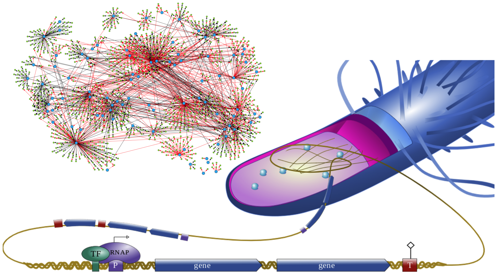

# Cell differentiation introduction {.unnumbered}

Cell differentiation is the process by which initially similar cells acquire distinct 
identities and functions. In a multicellular organism, most cells contain the same 
genetic information, yet they can become very different: in animals, an undifferentiated 
cell can become a neuron, muscle cell, or blood cell. Similarly, single-cell organisms, 
for example bacterial cells, can be in a cell state of exponential growth or stationary phase.

This raises a fundamental question: How can the same genome generate such a diversity 
of cell types/states?

Differentiation is not controlled by a single gene acting alone. Instead, cell identity 
emerges from interactions between genes, transcription factors, signalling pathways, 
and feedback mechanisms. These interactions form regulatory networks that determine 
which genes are active, which are repressed, and how a cell responds to its environment. 
Importantly, these networks can generate stable states: once a cell adopts a particular 
identity, regulatory interactions may help maintain that identity over time.

{#vegmini1 width=150%}

Transcription factors are master regulators of gene expression. These are DNA-binding 
proteins that regulate gene transcription by binding to gene promoters, recruit other 
proteins, or Pol II, ultimately switching gene expression $ON$ or $OFF$. Interestingly,
in *E. coli*, plants and animals it is estimated that 5-10% of the genes in their genomes 
are transcription factors, and then this relative small portion of the genome controls 
the expression of the rest. 

Computational models help us study how transcription factor activity is regulated, how 
do they form netwokrs underlying cell identity and behavior. Using a model we can ask:

- How can a network produce multiple stable cell identities, and how are these modified by mutations? 
- What are the information processing motifs that help cells make decisions in response to intrinsic cues and environmental signals?

In Part III you will learn how to use computational models to build and simulate gene 
regulatory networks, to understand how their dynamics generate gene expression patterns 
that establish and maintain different cell types. 