---
params:
  show_answers: false
---

# Gene regulation in time 

## Introduction

In this practical you will get hands on experience into making gene regulatory networks 
models. First you will practice how to encode regulatory interactions into ordinary 
differential equations and logical rules. Next you will use examples of Boolean networks to study 
their self-sustained activity configurations (attractors) (@rozum2023boolean).
Lastly, you will learn how to predict the genes that cause cell fate transitions (attractor changes). 

Today we will use the following python file: `WC07_Gene_regulatory_networks_I.py`.  In it you will find 
the parameters, functions and execution code. First have a look at the functions; look at what each takes as input and returns as output and how they are used in the `main`. 


## Regulatory interactions

In the `main` you have a Boolean and an ODE model to simulate an $AND$ gate where the variable $A$ and variable $B$ are both needed to positively regulate $C$. This could represent that $A$ and $B$ are transcription factors that form a protein complex, and that it is via this complex that they can bind the promoter of $C$ to promote its expression. 

While `ODEgeneRegulation()` encodes this regulation with an ordinary differential equation that 
requires several parameters, `logicalRule()` only needs the logical operator relating the input genes. 

**ODE implementation**

$\frac{dC}{dt}=p\frac{A^n}{K^n+A^n}.\frac{B^n}{K^n+B^n}-dC$

Where $p$ is the production rate, $K$ is the half saturation constant (represents the affinity of a TF 
to the promoter), $n$ is the cooperativity of transcription factor binding, and is the same for $A$ and 
$B$, $d$ is the decay rate. 

**Logical rule implementation**

$C_{t+1}=A_t$ & $B_t$

Running the code will produce a plot showing the value of $C$ for different combination of values of $A$ and $B$. Both implementations of this regulatory interaction produce qualitatively the same effect, i.e. $C$ is active when both $A$ and $B$ are active. Yet, the ODE version recovers quantitative differences in $C$ activity with values higher than 1. Notice that the exploration values for the ODE model is 11 values (0,1,2,3,4,5,6,7,8,9,10), while for a Boolean model is 2 (0 or 1). 

:::{#exr-non}
## Comparing ODEs and Boolean

 Why is the activity of $C$ higher in the ODE output than the Boolean one? 
:::

::: {.content-visible when-meta="params.show_answers"}
  > **Answer** In both cases $C$ has maximum activity when both $A$ and $B$ are active/expressed. 
  > Whereas in a Boolean model the activity of the variables can be either 0 or 1 and thus we only 
  > see $C$ =1, in an ODE the variables can have continuous values with the maximum level determined 
  > by the production and the decay rate parameters ($p/d$). This is the reason $C$ has values close 
  > to 5 in the ODE output. According to the parameters we picked $p/d = 10$. $C$ reaches this 
  > level if you run the simulation for longer and reduce $K$.
  > 
  > 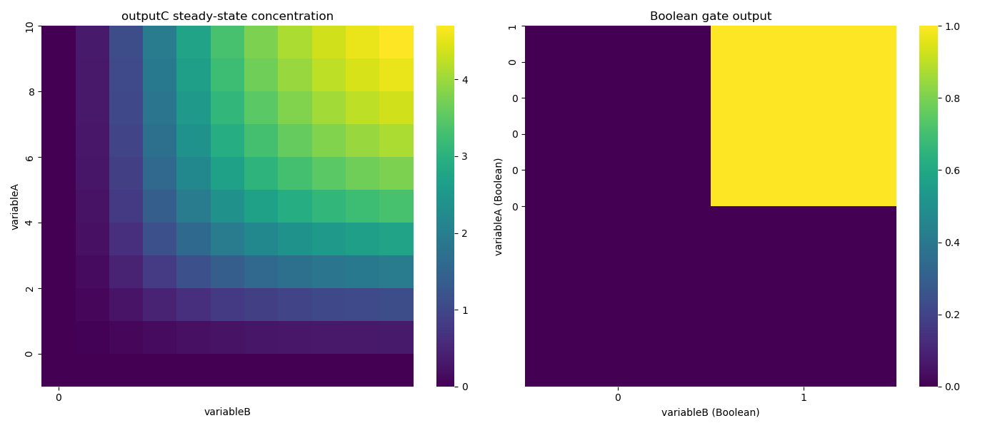{#vegmini1}
:::

:::{#exr-non}

## Altorithmic thinking:

Modify the code to implement different regulatory functions with the ODE and Boolean models. 
You need to modify the logical operator in the Boolean section, and to modify the $doutputC$ 
equation in the `ODEgeneRegulation` function. You can also change the parameters in the ODE 
to see how that changes the activity of $C$: 

**Regulatory functions: **

1. Either `A` or `B` can activate `C`. 

2. `A` represses `C`.

3. `A` and `B` together repress `C`. 

4. `A` represses `C` and `B` activates it.

5. `A` or `B` can activate `C`, but not when both are active at the same time. 

6. Include an extra input variable, and make a multi-dimensional logical gate, or 
try any other biological scenario yon can think of.

:::

::: {.content-visible when-meta="params.show_answers"}
  > **Answer** See `Boolean_answered-8.3.py` to see an implementation of the regulatory interactions listed
  > above. 
  > 
  > 1. $OR$ gate: **A** $OR$ **B**
  > 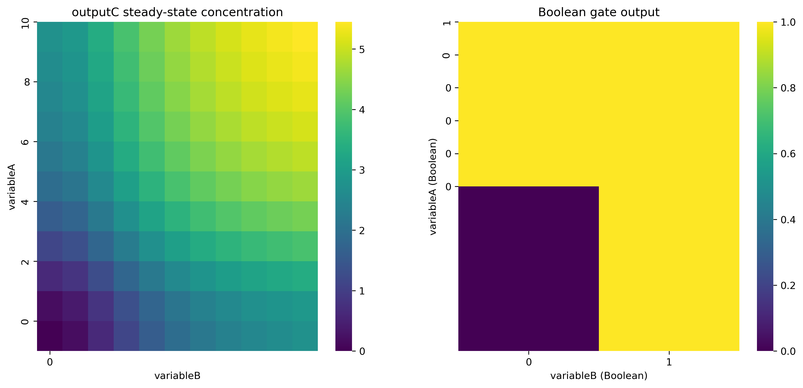{#vegmini1}  
  >
  > 2. $NOT$ gate: $NOT$ **A**
  > 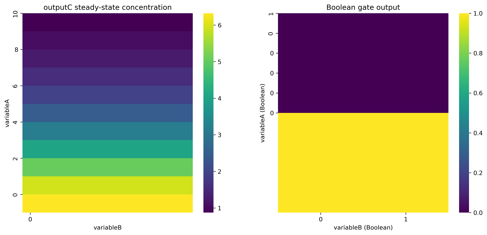{#vegmini1}  
  > 
  > 3. combination of $NOT$ and $AND$ gate: $NOT$ **A** $AND$ $NOT$ **B**
  > 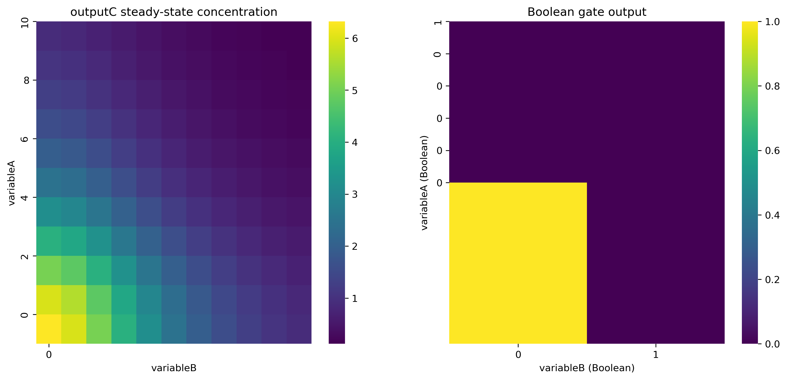{#vegmini1}  
  > 
  > looks quite different if it is an $OR$ gate:  $NOT$ **A** $OR$ $NOT$ **B**
  > 
  > 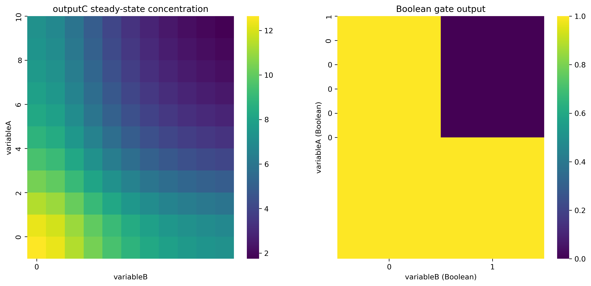{#vegmini1}  
  >
  > 4. There are two possibilities because it is not specified which interaction is 
  > "stronger". Here we show when A is stronger. Option 1: $NOT$ **A** $AND$ **B**. 
  > 
  > 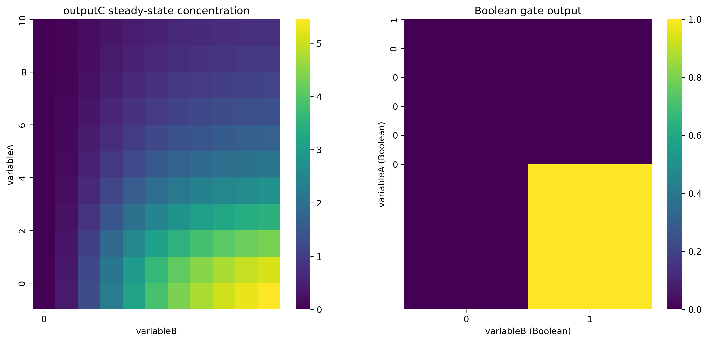{#vegmini1}  
  > 
  > 5. $XOR$ gate (**A** $XOR$ **B**), meaning either but not both at the same time. 
  > 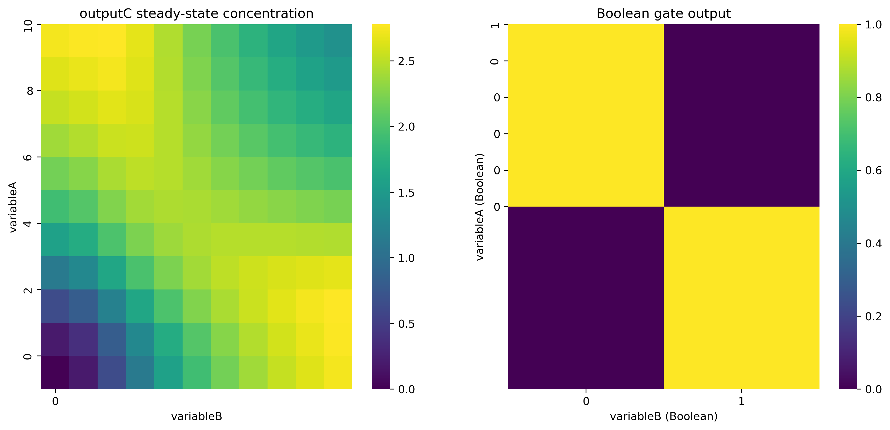{#vegmini1}  

:::

:::{#exr-non}


## Biology 

Is there a logical gate that can be better represented with an ODE than with Boolean logic? Give an  
examples of biological regulatory interactions that can be described with each logical gate? 

:::

:::{.content-visible when-meta="params.show_answers"}

  > **Answer** All logical gates can be modelled correctly with either approach. With Boolean models 
  > we look quantitative resolution, with ODE we can model many more values than 0 and 1. Whether
  > one or the other is better, depends on what do you want to answer with the model.
  > 
  > Biological examples that can be modelled with the logical gates: 
  > 
  > - $AND$ gate can be that both genes code for transcription factors that form a protein complex that 
  > binds a promoter to regulate gene expression of $X$. It can also represent that one regulator 
  > promotes the expression of $X$, while the other phosphorylates protein $X$. As the phosphorylated
  > $X$ is the active form, both regulatory interactions are needed ($AND$). 
  > 
  > - $OR$ is that either TF can bind promoter and activate transcription. 
  > 
  > - $NOT$ is that a TF blocks the promoter so that activating TF cannot bind.
  > 
  > - $NOT$ **A** $AND$ $NOT$ **B** is that both TFs are repressors of the same gene. 
  > 
  > - $NOT$ **A** $AND$ **B** is that A is a repressor and B is an activator. 
  > 
  > - $XOR$ gate can be a promoter where either A or B can bind, the complex AB cannot bind. 


:::
## Gene regulatory network

Now let's move to a network model made of many individual regulatory interactions (@garcia2020system). 
This model includes many regulatory interactions discovered for the cells of plant roots through years
of experimental research. Here, all this knowledge is encoded as logical rules. 

::: {.callout-note collapse="true"}
## Function: Boolean network - Root

``` python
def rootNetwork(parameters): 
    """Evaluate one synchronous update of the root gene-regulatory network.

    Args:
        parameters: Mapping of gene names (CK, ARR1, SHY2, AUXIAAR, ARFR,
            ARF10, ARF5, XAL1, PLT, AUX, SCR, SHR, MIR165, PHB, JKD, MGP,
            WOX5, and CLE40) to their current Boolean (0/1) values.

    Returns:
        Tuple of updated Boolean values in the same gene order listed above.
    """
    CK=parameters['CK']
    ARR1=parameters['ARR1']
    SHY2=parameters['SHY2']
    AUXIAAR=parameters['AUXIAAR']
    ARFR=parameters['ARFR']
    ARF10=parameters['ARF10']
    ARF5=parameters['ARF5']
    XAL1=parameters['XAL1']
    PLT=parameters['PLT']
    AUX=parameters['AUX']
    SCR=parameters['SCR']
    SHR=parameters['SHR']
    MIR165=parameters['MIR165']
    PHB=parameters['PHB']
    JKD=parameters['JKD']
    MGP=parameters['MGP']
    WOX5=parameters['WOX5']
    CLE40=parameters['CLE40']
    w_CK = (PHB and (1-ARFR) or (1-SHR))
    w_ARR1 = CK and (1-SCR)
    w_SHY2 = (1-AUX) and ARR1
    w_AUXIAAR = 1-AUX
    w_ARFR = 1-AUXIAAR
    w_ARF10 = (1-AUXIAAR) and (1-(JKD and SHR))
    w_ARF5 = (PHB or PLT) and (1-(SHR and MGP)) and (1-AUXIAAR)and (1-SHY2)
    w_XAL1= ARFR
    w_PLT= ARF5 or XAL1 or ARFR or WOX5
    w_AUX = 1
    w_SCR = SHR and SCR and JKD
    w_SHR = SHR
    w_MIR165 = (1-PHB) or (SCR and SHR and (1-ARR1))
    w_PHB = (((1-ARR1) and PLT) or PHB) and  (1-MIR165)
    w_JKD = (1-PHB) and SCR and SHR
    w_MGP = (1-ARF5) and SCR and SHR
    w_WOX5 = (1-ARF10) and ARF5 and (1-CLE40)
    w_CLE40 = 1-SHR
    return(w_CK,w_ARR1,w_SHY2,w_AUXIAAR,w_ARFR,w_ARF10,w_ARF5,w_XAL1,w_PLT,w_AUX,w_SCR,w_SHR,w_MIR165,w_PHB,w_JKD,w_MGP,w_WOX5,w_CLE40)

```
:::

The model consists of 18 variables representing transcription factors, hormones, 
peptides. Look at the `rootNetwork()` function below. This function defines the 
state of 18 variables (CK, ARR1, SHY2, AUXIAAR, etc.) based on an input stored in 
`parameters`, then it updates the state of each variable using the logical operators 
$AND$, $OR$ and $NOT$; the result is stored in `w_variable`. The function returns 
the update state `w_variable` for each of the 18 variables.  

### Time course simulation
To solve this Boolean network we have to first define an initial condition for each of these 18 variables, and then update their state using the logical functions stored in `rootNetwork`. We will repeat this updating for a given number of time steps (`timesteps`). This network has a total of 2^18 initial conditions, we are going to explore one of them at random by initializing the state of the variables with 0 or 1. 
First, we need to input the initial condition of the variables to `rootNetwork()` 
using `parameters`. Next, we save the output of this function as the new current 
state. We repeat this procedure iteratively for as many time steps as we defined, 
saving in a matrix the time course of the simulation. This can be done using a 
for loop as shown below: 

::: {.callout-note collapse="true"}
## Function: plotting the timecourse simulation
```python
def plotBooleanTimecourse(matrix,timesteps):
    """Plot the boolean network timecourse.

    Input:
        matrix: 2D array with rows representing time steps and columns representing
            variables (CK, ARR1, SHY2, ... CLE40); expected values are 0/1.
        timesteps: number of time steps to plot.

    Output:
        Saves a heatmap to 'output/1-boolean-IC-timecourse.png' and displays it.
        Returns nothing.
    """
    plt.figure(figsize=(16, 8))
    variable_names = ['CK', 'ARR1', 'SHY2', 'AUXIAAR', 'ARFR', 'ARF10', 'ARF5', 'XAL1', 
                  'PLT', 'AUX', 'SCR', 'SHR', 'MIR165', 'PHB', 'JKD', 'MGP', 'WOX5', 'CLE40']
    sns.heatmap(matrix, cmap="viridis", cbar=True, xticklabels=variable_names, cbar_kws={"ticks": [0, 1]})
    #sns.heatmap(matrix, cmap=sns.color_palette(["red", "green"], as_cmap=True), cbar=True, xticklabels=variable_names, cbar_kws={"ticks": [0, 1]})
    plt.grid(visible=True, which='both', axis='both', color='white', linewidth=0.5)
    plt.xticks(np.arange(len(variable_names)), variable_names, rotation=90)
    plt.yticks(np.arange(timesteps+1), np.arange(timesteps+1))
    plt.xlabel("variables")
    plt.ylabel("Timesteps")
    plt.title("Boolean Network Timecourse")
    plt.savefig("output/1-boolean-IC-timecourse.png", dpi=300, bbox_inches='tight')
    plt.show()

```
Run the program several times. Does the attractor recovered is always the same? 
How many different attractors does the model recover?

:::

::: {.callout-note collapse="true"}
## Function: timecourse simulation (remember to call it in the Execution part of the code)
```python
def TimecourseSimulation():
    timesteps=20
    variables=18
    # Create the timecourse matrix for the updating of the Boolean network. The first row stores a random 
    # binary initial state for all 18 variables, and each subsequent row is obtained by updating the
    # network from the previous state according to the logical rules encoded in rootNetwork().
    # This simulates how the gene regulatory network evolves over time from a random starting point.
    matrix = np.zeros((timesteps+1, variables), dtype=int)
    matrix[0,:] = np.random.randint(0, 2, size=variables) # Random initial condition
    for i in range(timesteps):
        # Pass the current state of all variables to the update function so it can compute the next
        # state of the network based on the Boolean rules.
        parameters= {'CK': matrix[i,0], 'ARR1': matrix[i,1], 'SHY2': matrix[i,2], 'AUXIAAR': matrix[i,3], 'ARFR': matrix[i,4], 'ARF10': matrix[i,5], 'ARF5': matrix[i,6], 'XAL1': matrix[i,7], 'PLT': matrix[i,8], 'AUX': matrix[i,9], 'SCR': matrix[i,10], 'SHR': matrix[i,11], 'MIR165': matrix[i,12], 'PHB': matrix[i,13], 'JKD': matrix[i,14], 'MGP': matrix[i,15], 'WOX5': matrix[i,16], 'CLE40': matrix[i,17]}
        # Save the updated Boolean state for the next time step in the matrix.
        matrix[i+1, :] = rootNetwork(parameters) # Save the output in i+1
    plotBooleanTimecourse(matrix,timesteps)
```
:::

Use the function `plotBooleanTimecourse()` to make a heatmap plot of how each variable in the network 
is updated in the simulated timesteps. 30 timesteps is probably enough for this network to reach an attractor. 


:::{.content-visible when-meta="params.show_answers"}

  > 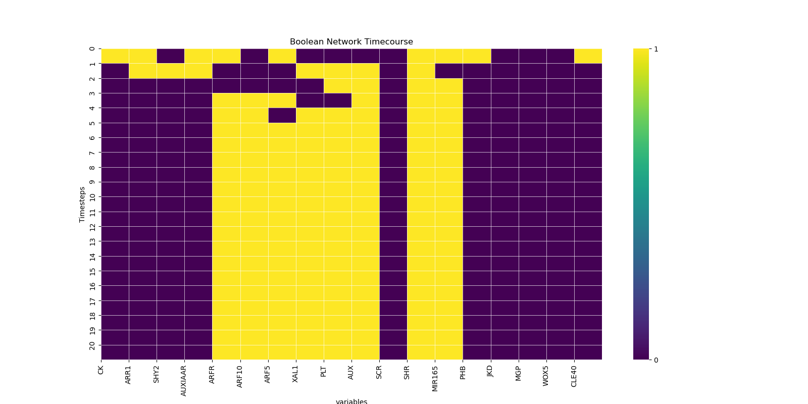{#vegmini1}
  > The output might be different every time you run the model. That is because this
  > network has 6 different attractors 
   

:::

:::{#exr-non}
## Algorithmic thinking
Try this initial condition: 

```python
matrix[0,:]=[0,1,1,0,1,1,0,0,1,0,1,1,1,1,1,0,1,0]
```

Solve this initial condition using `rootNetwork()` and the `rootNetworkAsynchronous()` (see below). Compare the output in 
each case. What happens and why? What does an asynchronous update do?
:::

::: {.callout-note collapse="true"}
## Root network asynchronous updating
```python
def rootNetworkAsynchronous(parameters):
    """Perform one probabilistic asynchronous update of the root gene network.

    Each node independently has a 95% chance of being updated according to
    its Boolean regulation rule; otherwise, its current value is retained.

    Args:
        parameters: Mapping of current Boolean (0/1) values for CK, ARR1,
            SHY2, AUXIAAR, ARFR, ARF10, ARF5, XAL1, PLT, AUX, SCR, SHR,
            MIR165, PHB, JKD, MGP, WOX5, and CLE40.

    Returns:
        Tuple of updated values, ordered as CK, ARR1, SHY2, AUXIAAR, ARFR,
        ARF10, ARF5, XAL1, PLT, AUX, SCR, SHR, MIR165, PHB, JKD, MGP, WOX5,
        and CLE40.
    """
    CK=parameters['CK']
    ARR1=parameters['ARR1']
    SHY2=parameters['SHY2']
    AUXIAAR=parameters['AUXIAAR']
    ARFR=parameters['ARFR']
    ARF10=parameters['ARF10']
    ARF5=parameters['ARF5']
    XAL1=parameters['XAL1']
    PLT=parameters['PLT']
    AUX=parameters['AUX']
    SCR=parameters['SCR']
    SHR=parameters['SHR']
    MIR165=parameters['MIR165']
    PHB=parameters['PHB']
    JKD=parameters['JKD']
    MGP=parameters['MGP']
    WOX5=parameters['WOX5']
    CLE40=parameters['CLE40']
    # With 0.5 probability, set w_CK as before, otherwise set to 0
    if np.random.rand() < 0.95:
        w_CK = (PHB and (1-ARFR) or (1-SHR))
    else:
        w_CK = CK

    if np.random.rand() < 0.95:
        w_ARR1 = CK and (1-SCR)
    else:
        w_ARR1 = ARR1

    if np.random.rand() < 0.95:
        w_SHY2 = (1-AUX) and ARR1
    else:
        w_SHY2 = SHY2

    if np.random.rand() < 0.95:
        w_AUXIAAR = 1-AUX
    else:
        w_AUXIAAR = AUXIAAR

    if np.random.rand() < 0.95:
        w_ARFR = 1-AUXIAAR
    else:
        w_ARFR = ARFR

    if np.random.rand() < 0.95:
        w_ARF10 = (1-AUXIAAR) and (1-(JKD and SHR))
    else:
        w_ARF10 = ARF10

    if np.random.rand() < 0.95:
        w_ARF5 = (PHB or PLT) and (1-(SHR and MGP)) and (1-AUXIAAR) and (1-SHY2)
    else:
        w_ARF5 = ARF5

    if np.random.rand() < 0.95:
        w_XAL1 = ARFR
    else:
        w_XAL1 = XAL1

    if np.random.rand() < 0.95:
        w_PLT = ARF5 or XAL1 or ARFR or WOX5
    else:
        w_PLT = PLT

    if np.random.rand() < 0.95:
        w_AUX = 1
    else:
        w_AUX = AUX

    if np.random.rand() < 0.95:
        w_SCR = SHR and SCR and JKD
    else:
        w_SCR = SCR

    if np.random.rand() < 0.95:
        w_SHR = SHR
    else:
        w_SHR = SHR

    if np.random.rand() < 0.95:
        w_MIR165 = (1-PHB) or (SCR and SHR and (1-ARR1))
    else:
        w_MIR165 = MIR165

    if np.random.rand() < 0.95:
        w_PHB = (((1-ARR1) and PLT) or PHB) and (1-MIR165)
    else:
        w_PHB = PHB

    if np.random.rand() < 0.95:
        w_JKD = (1-PHB) and SCR and SHR
    else:
        w_JKD = JKD

    if np.random.rand() < 0.95:
        w_MGP = (1-ARF5) and SCR and SHR
    else:
        w_MGP = MGP

    if np.random.rand() < 0.95:
        w_WOX5 = (1-ARF10) and ARF5 and (1-CLE40)
    else:
        w_WOX5 = WOX5

    if np.random.rand() < 0.95:
        w_CLE40 = 1-SHR
    else:
        w_CLE40 = CLE40
    return(w_CK,w_ARR1,w_SHY2,w_AUXIAAR,w_ARFR,w_ARF10,w_ARF5,w_XAL1,w_PLT,w_AUX,w_SCR,w_SHR,w_MIR165,w_PHB,w_JKD,w_MGP,w_WOX5,w_CLE40)
```
:::

:::{.content-visible when-meta="params.show_answers"}

  > **Answer** The synchronous approach updates all genes every timestep, which may not be realistic as transcription,
  > translation and protein degradation do not necessarily occur at the same rate for all modelled genes, and these
  > processes are inherently noisy. Thus, asynchronously updating the variables is a good idea.
  > The asynchronous updating function introduces a probability of update (95%) to each variable in 
  > the simulation. This means the variables might not be all updated each timestep. The initial condition 
  > converges to a cyclic attractor in the synchronous updating function (`rootNetwork()`), and to a fixed
  > point attractor in the asynchronous function (`rootNetworkAsynchronous()`). This means the cyclic 
  > behaviour recovered with the synchronous updating scheme was an artifact of updating all the variable at 
  > the same time. 

:::

:::{#exr-non}

## Algorithmic thinking
From here onwards use the `rootNetworkAsynchronous()` function.
Make your own function `InitialConditions` to solve 100 random initial conditions, and then save the final activity configurations (attractors) in an `attractors matrix`. 

The `attractors matrix` should have the dimensions `(initial_conditions, variables)` so that you can plot 
the results using the `plotBooleanAttractors()` function. 


::: {.callout-note collapse="true"}
## Code for plotting the timecourse simulation
```python
def plotBooleanAttractors(attractors):
    """Plot the recovered boolean attractors.

    Input:
        attractors: 2D array where each row is a distinct attractor state and each
            column corresponds to a gene or regulatory node.

    Output:
        Saves a heatmap to 'output/1-boolean-many-ICs.png' and displays it.
        Returns nothing.
    """
    # here we plot the attractors found
    plt.figure(figsize=(16, 8))
    variable_names = ['CK', 'ARR1', 'SHY2', 'AUXIAAR', 'ARFR', 'ARF10', 'ARF5', 'XAL1', 
                  'PLT', 'AUX', 'SCR', 'SHR', 'MIR165', 'PHB', 'JKD', 'MGP', 'WOX5', 'CLE40']
    sns.heatmap(attractors, cmap="viridis", cbar=True, xticklabels=variable_names, cbar_kws={"ticks": [0, 1]})
    #sns.heatmap(attractors, cmap=sns.color_palette(["red", "green"], as_cmap=True), cbar=True, xticklabels=variable_names,cbar_kws={"ticks": [0, 1]})
    plt.grid(visible=True, which='both', axis='both', color='white', linewidth=0.5)
    plt.xticks(np.arange(len(variable_names)), variable_names, rotation=90)
    ICs = attractors.shape[0]
    plt.yticks(np.arange(ICs), )
    plt.xlabel("variables")
    plt.ylabel("Attractors")
    plt.title("Recovered Attractors")
    plt.savefig("output/1-boolean-many-ICs.png", dpi=300, bbox_inches='tight')
    plt.show()

```
:::

* Notice here you should save **only the final state** for each initial condition you explore. 


```python
def InitialConditions():
    timesteps=100
    ICs=100

# your code

    plotBooleanAttractors(attractors) # it takes as argument your matrix of attractors
```
:::

:::{.content-visible when-meta="params.show_answers"}

  > **Answer** See `WC07_Question5.py` to see an implementation of this for loop.
  > 
  > 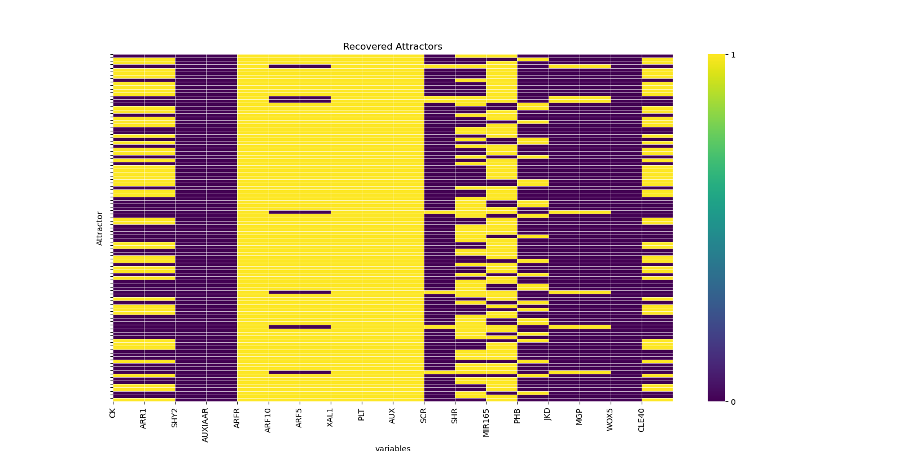{#vegmini1}

:::

You should have found many different attractors. On Monday we learned of the use of multidimensional reduction techniques to study the gene expression patterns of single cell transcriptomics. Let's use that tecnhique to 
see how the attractors we recovered relate to each other. For this you need to install the `umap-learn` package 
using this line:

```python
pip install umap-learn
```

More details on how to install packages here: <a href="https://modelinglife-uu.github.io/intro_to_python.html">Introduction to python</a>.

Now that you have installed `umap-learn`, let's run a UMAP of the attractors you recovered 
(this takes a bit of time to run, so be patient 😉):

::: {.callout-note collapse="true"}
## Function: UMAP for the attractors matrix. Remember to call at the end of InitialConditions()
```python
def UMAPBoolean(attractors):
    # 3.1 UMAP dimensionality reduction - for this it is better to increase the number of ICs to 500
    reducer = umap.UMAP(n_neighbors=10, min_dist=0.1, metric='hamming', random_state=42)
    attractors_umap = reducer.fit_transform(attractors)

    plt.figure(figsize=(11, 8))
    # Color cells by their attractor state (e.g., by the sum of active variables)
    colors = np.sum(attractors, axis=1)
    # If the second to last position in attractor is 1, color that point purple
    special_mask = attractors[:, -2] == 1
    scatter = plt.scatter(attractors_umap[~special_mask, 0], attractors_umap[~special_mask, 1], edgecolor='k')
    plt.scatter(
        attractors_umap[(attractors[:, 11] == 1) & (attractors[:, 13] == 1), 0],
        attractors_umap[(attractors[:, 11] == 1) & (attractors[:, 13] == 1), 1],
        color='red', edgecolor='k', label='Vascular 1'
    )
    plt.scatter(
        attractors_umap[(attractors[:, 12] == 1) & (attractors[:, 11] == 1), 0],
        attractors_umap[(attractors[:, 12] == 1) & (attractors[:, 11] == 1), 1],
        color='yellow', edgecolor='k', label='Vascular 2'
    )
    plt.scatter(
        attractors_umap[(attractors[:, 17] == 1) & (attractors[:, 13] == 1), 0],
        attractors_umap[(attractors[:, 17] == 1) & (attractors[:, 13] == 1), 1],
        color='orange', edgecolor='k', label='Vascular 3'
    )
    plt.scatter(
        attractors_umap[(attractors[:, 17] == 1) & (attractors[:, 12] == 1), 0],
        attractors_umap[(attractors[:, 17] == 1) & (attractors[:, 12] == 1), 1],
        color='brown', edgecolor='k', label='Columella'
    )
    plt.scatter(
        attractors_umap[(attractors[:, 15] == 1) & (attractors[:, 14] == 1), 0],
        attractors_umap[(attractors[:, 15] == 1) & (attractors[:, 14] == 1), 1],
        color='green', edgecolor='k', label='Endodermis'
    )
    plt.scatter(attractors_umap[special_mask, 0], attractors_umap[special_mask, 1], color='violet', edgecolor='k', label='QC')
    plt.legend()
    plt.xlabel("UMAP 1")
    plt.ylabel("UMAP 2")
    plt.title("UMAP projection of attractors")
    plt.grid(True)
    plt.savefig("output/1-boolean-UMAP.png", dpi=300, bbox_inches='tight')
    plt.show()
```
:::

```python
UMAPBoolean(attractors)
```

:::{#exr-non}

## Biology / Conceptual thinking
Why do you see clearly defined groups and not a continuous distribution of attractors? 
:::

:::{.content-visible when-meta="params.show_answers"}

  > **Answer** We see clearly defined groups because we are doing the UMAP with the cells that have 
  > already reached an attractor, and not while they are in their trajectory towards the attractor. 
  >
  > 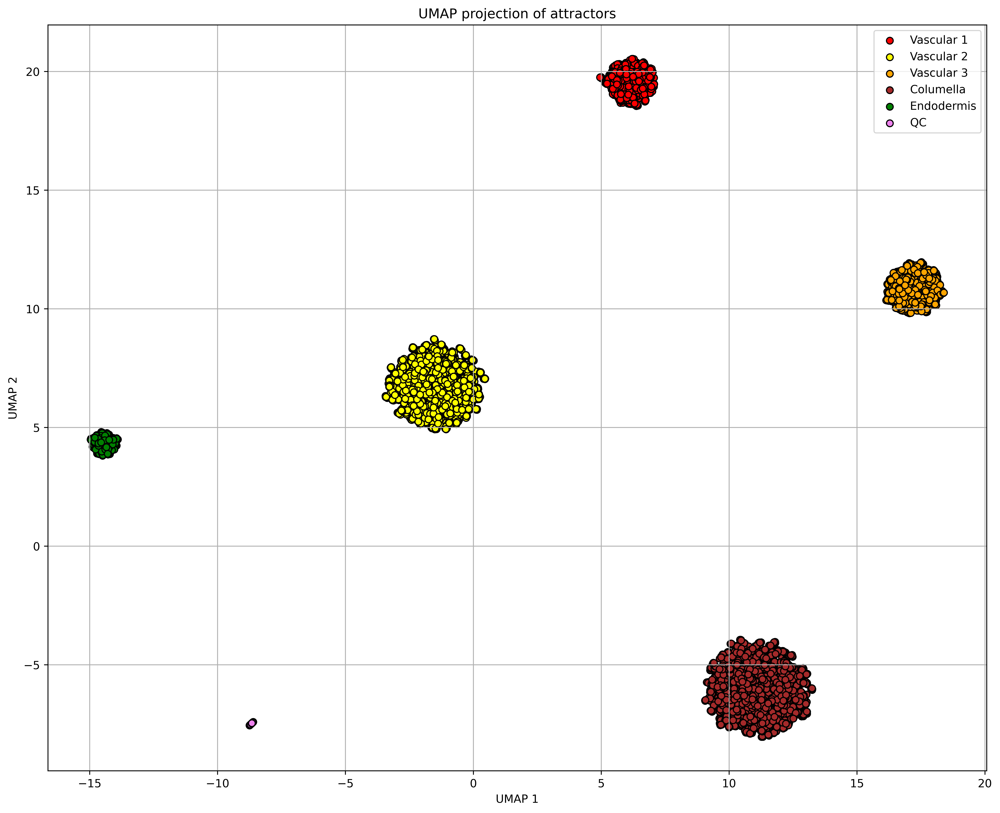{#vegmini1}

:::

Now let's recover the unique attractors you found. First, let's group similar attractors using the 
`sorted()` function:

```python
attractors_sorted = np.array(sorted(attractors.tolist()))
plotBooleanAttractors(attractors_sorted) 
```
:::{.content-visible when-meta="params.show_answers"}

  > 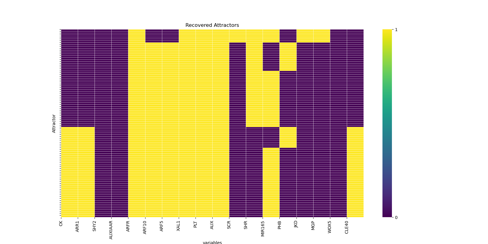{#vegmini1}

:::

:::{#exr-non}

## Biology / Conceptual thinking
Do some attractors occur more frequently than others. Why is this? 
:::

:::{.content-visible when-meta="params.show_answers"}

  > **Answer** Yes, some attractors occur more often than others, and this is a consequence of the 
  > regulatory interactions of the model. The number of initial conditions that reached a specific attractor 
  > is a reflection of the size of their basin of attraction. The basins of attraction (all 
  > variable configurations  that converge to an attractor) are shaped by the AND, OR, and NOT gates in 
  > each of the modelled variables. Imagine cells are like marbles moving through a landscape, such that 
  > the regulatory interactions define the “rolling” direction, until eventually they land in different 
  > basins of attraction as they acquire different cell states. Here the landscape is multidimensional 
  > (as many dimensions as variables in the model, so 18). 

:::

:::{#exr-non}

## Biology
Some variables are active (1) in the majority of the attractors, others in half, and others in very few. 
In how many attractors is the variable SHR active? What does this suggest about its regulation?
:::

:::{.content-visible when-meta="params.show_answers"}

  > **Answer** How often a variable is active in the attractors, is defined by their logical rules. For
  > example, SHR logical rule is SHR = SHR. This means that SHR is an input variable, that is not regulated by 
  > any other variable. This splits the state space perfectly in two halves: one with SHR active and another 
  > with SHR inactive. You can implement this in `Boolean_answered-8.3.py` to visualize this split. 
  >
  > 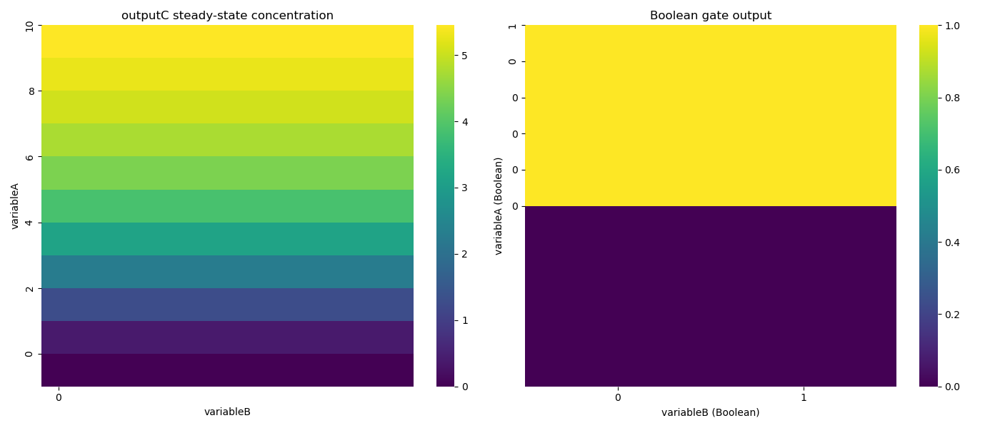{#vegmini1}

:::

Now let's remove the repeated rows (duplicate attractor states) to see unique attractors using the 
`np.unique()` function: 

```python
_, unique_indices = np.unique(attractors, axis=0, return_index=True)
attractors_unique = attractors[np.sort(unique_indices)]
plotBooleanAttractors(attractors_unique) 
```

:::{.content-visible when-meta="params.show_answers"}

  > 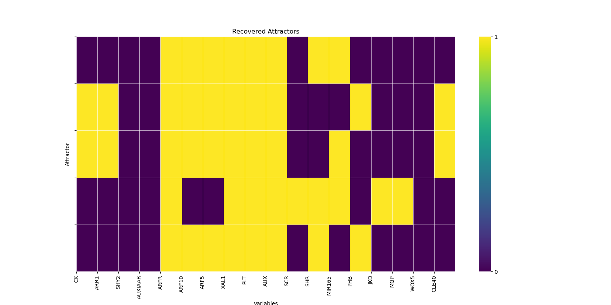{#vegmini1}

:::
:::{#exr-non}

## Biology / conceptual thinking
How many unique attractors did you find? Compare them with the ones reported in the paper. Are they all fixed points? 
:::

:::{.content-visible when-meta="params.show_answers"}

  > **Answer** This depends on how many initial conditions you test. The more initial conditions, the 
  > more likely you will find the maximum of 6 fixed point attractors this model can produce when 
  > solving the network asynchronously. 

:::

## Cell differentiation – jumping from one attractor to another

Whether a continuous or a discrete model is better, depends on the question we want to answer.
To study the logic of cell differentiation, a Boolean model might be more appropriated particularly if we want to study the role of many genes, but lack details of the parameters underlying each reaction. Alternatively, if we wish to study the role of quantitative information in how cells change from one cell fate to another, a continuous model might be more appropriate. 

Here we will see how we can convert the Boolean model to a continuous one and use it to predict which 
regulators are able of causing a change in the state of the system (changes in cell fate!)

::: {.callout-note collapse="true"}
## Function: Root Network, ODE version
```python
def rootNetworkODE(a, t, parameters):
    """
    Compute the time derivatives for the root developmental gene regulatory network.

    This function evaluates the ODE system used to model interactions among root
    cell identity regulators (e.g. CK, ARR1, SHY2, AUX/IAA, ARF, PLT, SCR, SHR,
    MIR165, PHB, JKD, MGP, WOX5, CLE40). It combines regulatory weights using
    a sigmoid transfer function and subtracts decay terms for each variable.

    Inputs
    ------
    a : array-like
        Current state vector containing the values of all model variables in the
        order: [CK, ARR1, SHY2, AUXIAAR, ARFR, ARF10, ARF5, XAL1, PLT, AUX,
        SCR, SHR, MIR165, PHB, JKD, MGP, WOX5, CLE40].
    t : float
        Time variable for the ODE system. In this autonomous model it is not used
        explicitly in the equations.
    parameters : dict
        Dictionary containing the model parameters, including:
        - 'decayrate': degradation/decay constant for each variable.
        - 'h': steepness parameter controlling the sigmoid response.

    Outputs
    -------
    tuple
        A tuple with the derivatives for each state variable in the same order as
        the input vector: (dCK, dARR1, dSHY2, dAUXIAAR, dARFR, dARF10, dARF5,
        dXAL1, dPLT, dAUX, dSCR, dSHR, dMIR165, dPHB, dJKD, dMGP, dWOX5,
        dCLE40).
    """
    decayrate = parameters['decayrate']  # decay rate
    h = parameters['h']  # this controls the shape of the sigmoid function
    CK=a[0]
    ARR1=a[1]
    SHY2=a[2]
    AUXIAAR=a[3]
    ARFR=a[4]
    ARF10=a[5]
    ARF5=a[6]
    XAL1=a[7]
    PLT=a[8]
    AUX=a[9]
    SCR=a[10]
    SHR=a[11]
    MIR165=a[12]
    PHB=a[13]
    JKD=a[14]
    MGP=a[15]
    WOX5=a[16]
    CLE40=a[17]
    w_CK = max(min(PHB,1-ARFR),1-SHR)
    w_ARR1 = min(CK,1-SCR)
    w_SHY2 = min(1-AUX,ARR1)
    w_AUXIAAR = 1-AUX
    w_ARFR = 1-AUXIAAR
    w_ARF10 = min(1-AUXIAAR,1-min(JKD,SHR))
    w_ARF5 = min(max(PHB,PLT),1-min(SHR,MGP),1-AUXIAAR,1-SHY2)
    w_XAL1= ARFR
    w_PLT= max(ARF5,XAL1,ARFR,WOX5)
    w_AUX = 1
    w_SCR = min(SHR,SCR,JKD)
    w_SHR = SHR
    w_MIR165 = max(1-PHB,min(SCR,SHR,1-ARR1))
    w_PHB = min(max(min(1-ARR1,PLT),PHB),1-MIR165)
    w_JKD = min(1-PHB,SCR,SHR)
    w_MGP = min(1-ARF5,SCR,SHR)
    w_WOX5 = min(1-ARF10,ARF5,1-CLE40)
    w_CLE40 = 1-SHR
    def sigmoid(w_variable,h):
        a=((-np.exp(0.5*h)+np.exp(-h*(w_variable)))/((1-np.exp(0.5*h))*(1+np.exp(-h*(w_variable-0.5)))))
        return(a)
    dCK = sigmoid(w_CK,h)-(decayrate*CK)
    dARR1 = sigmoid(w_ARR1,h)-(decayrate*ARR1)
    dSHY2 = sigmoid(w_SHY2,h)-(decayrate*SHY2)
    dAUXIAAR = sigmoid(w_AUXIAAR,h)-(decayrate*AUXIAAR)
    dARFR = sigmoid(w_ARFR,h)-(decayrate*ARFR)
    dARF10 = sigmoid(w_ARF10,h)-(decayrate*ARF10)
    dARF5 = sigmoid(w_ARF5,h)-(decayrate*ARF5)
    dXAL1 = sigmoid(w_XAL1,h)-(decayrate*XAL1)
    dPLT = sigmoid(w_PLT,h)-(decayrate*PLT)
    dAUX = sigmoid(w_AUX,h)-(decayrate*AUX)
    dSCR = sigmoid(w_SCR,h)-(decayrate*SCR)
    dSHR = sigmoid(w_SHR,h)-(decayrate*SHR)
    dMIR165 = sigmoid(w_MIR165,h)-(decayrate*MIR165)
    dPHB = sigmoid(w_PHB,h)-(decayrate*PHB)
    dJKD = sigmoid(w_JKD,h)-(decayrate*JKD)
    dMGP = sigmoid(w_MGP,h)-(decayrate*MGP)
    dWOX5 = sigmoid(w_WOX5,h)-(decayrate*WOX5)
    dCLE40 = sigmoid(w_CLE40,h)-(decayrate*CLE40)	       
    return(dCK, dARR1, dSHY2, dAUXIAAR, dARFR, dARF10, dARF5, dXAL1, dPLT, dAUX, dSCR, dSHR, dMIR165, dPHB, dJKD, dMGP, dWOX5, dCLE40)

```
:::

Compare the code of the functions `rootNetwork()` and `rootNetworkODE()`. Notice how in `rootNetworkODE()` 
the logical rules are represented with $min$ and $max$ functions (explained in the lecture), and then used 
in a sigmoidal function to create a continuous ODE model. 

* $AND$ operator is a $min$ function, $OR$ operator is a $max$ function, and $NOT$ operator is $1-x$. 

Use the code below to run a random initial condition for the 18 variables (IC) and see how the system behaves.

::: {.callout-note collapse="true"}
## Execution code: Solve ODE version of root model
```python
timerunning=10.1 
times = np.arange(0, timerunning, 0.1)

IC = np.random.randint(0, 2, size=18).tolist() #random initial condition
parameters = {'decayrate': 1, 'h': 50} 
cells = odeint(rootNetworkODE, IC, times, args=(parameters,)) 

plotODEroot(cells,times)
```
:::

::: {.callout-note collapse="true"}
## Function: Plotting output of Root model ODE version
```python
def plotODEroot(cells,times):
    """Plot root-network ODE trajectories and final state.

    Input:
        cells (ndarray): time series of gene activities, shape (n_timepoints, n_variables).
        times (array-like): simulation time points matching rows in cells.

    Output:
        None. Shows the trajectory plot and a heatmap of the final state, and saves the result to disk.
    """
    attractorode = cells[-1, :]  # last value of the ODE simulation

    variablesNames=['CK','ARR1','SHY2','AUXIAAR','ARFR','ARF10','ARF5','XAL1','PLT','AUX','SCR','SHR','MIR165','PHB','JKD','MGP','WOX5','CLE40']

    fig, (ax1, ax2) = plt.subplots(1, 2, figsize=(14, 6), gridspec_kw={'width_ratios': [3, 1]})

    # Time series plot
    for i, name in enumerate(variablesNames):
        ax1.plot(times, cells[:, i], label=name, linewidth=3, color=sns.color_palette("tab20", len(variablesNames))[i])
    ax1.set_xlabel('Time')
    ax1.set_ylabel('Gene activity')
    ax1.set_title('Root model (ODE version)')
    ax1.legend(loc='upper right', bbox_to_anchor=(1, 0.9))
    ax1.grid(True)

    # Heatmap of final state
    sns.heatmap(attractorode.reshape(-1, 1), yticklabels=variablesNames, cmap="viridis", ax=ax2, cbar=False)
    #sns.heatmap(attractorode.reshape(-1, 1), yticklabels=variablesNames, cmap=sns.color_palette(["red", "green"], as_cmap=True), ax=ax2, cbar=False)
    ax2.set_xticks([])
    ax2.set_ylabel('variables')
    ax2.set_title('Final state')
    ax2.set_aspect(0.7)  # Make the heatmap narrower
    plt.savefig("output/2-boolean-to-ode-dynamics.png", dpi=300, bbox_inches='tight')
    plt.tight_layout()
    plt.show()

````
:::


:::{#exr-non}

## Modeling choices
Do the attractors match those recovered with the Boolean network?
:::
:::{.content-visible when-meta="params.show_answers"}

  > **Answer** Yes. The ODE model is built with the same regulatory interactions from the Boolean model. 
  > The difference is that this model allows us to describe quantitative differences in the activity of the variables. 

:::

Now let’s use the model to study cell differentiation routes. Let’s start in the following 
initial condition (IC vector), and find a change in a variable that produce a jump to another 
attractor (end). For this you can simply flip the activity of a gene in the initial condition 
(from $0→1$ or $1→0$) and see the final attractor matches the desired end state. This simulated 
change mimics how an environmental signal may impinge in the regulatory network. 

::: {.callout-note collapse="true"}
## Function: Root Network, ODE version
```python
def plotODErootTransition(cells,times):
    """Plot ODE trajectories alongside the target root state.

    Input:
        cells (ndarray): time series of gene activities, shape (n_timepoints, n_variables).
        times (array-like): simulation time points matching rows in cells.

    Output:
        None. Shows the trajectory plot and two heatmaps (final state and target end state), and saves the result to disk.
    """
    attractorode = cells[-1, :]  # last value of the ODE simulation
    variablesNames=['CK','ARR1','SHY2','AUXIAAR','ARFR','ARF10','ARF5','XAL1','PLT','AUX','SCR','SHR','MIR165','PHB','JKD','MGP','WOX5','CLE40']
    end=[1,1,0,0,1,1,1,1,1,1,0,0,1,0,0,0,0,1]

    fig, (ax1, ax2, ax3) = plt.subplots(1, 3, figsize=(14, 6), gridspec_kw={'width_ratios': [3, 1, 1]})

    # Time series plot
    for i, name in enumerate(variablesNames):
        ax1.plot(times, cells[:, i], label=name, linewidth=3, color=sns.color_palette("tab20", len(variablesNames))[i])
    ax1.set_xlabel('Time')
    ax1.set_ylabel('Gene activity')
    ax1.set_title('Root model (ODE version)')
    ax1.legend(loc='upper right', bbox_to_anchor=(1, 0.9))
    ax1.grid(True)

    # Heatmap of final state
    sns.heatmap(attractorode.reshape(-1, 1), yticklabels=variablesNames, cmap="viridis", ax=ax2, cbar=False)
    #sns.heatmap(attractorode.reshape(-1, 1), yticklabels=variablesNames, cmap=sns.color_palette(["red", "green"], as_cmap=True), ax=ax2, cbar=False)
    ax2.set_xticks([])
    ax2.set_ylabel('variables')
    ax2.set_title('Final state')
    ax2.set_aspect(0.7)  # Make the heatmap narrower

    # Heatmap of desired end state
    sns.heatmap(np.array(end).reshape(-1, 1), yticklabels=variablesNames, cmap="viridis", ax=ax3, cbar=False)
    #sns.heatmap(np.array(end).reshape(-1, 1), yticklabels=variablesNames, cmap=sns.color_palette(["red", "green"], as_cmap=True), ax=ax3, cbar=False)
    ax3.set_xticks([])
    ax3.set_ylabel('variables')
    ax3.set_title('Desired end state')
    ax3.set_aspect(0.7)
    plt.savefig("output/2-boolean-to-ode-cell-fate-changes.png", dpi=300, bbox_inches='tight')
    plt.tight_layout()
    plt.show()
```
:::

::: {.callout-note collapse="true"}
## Execution code: Cell fate transitions with ODE version of root model
```python
# We start here: 
IC=[0,0,0,0,1,0,1,1,1,1,1,1,1,0,1,0,1,0]
# We want to end here. 
end=[1,1,0,0,1,1,1,1,1,1,0,0,1,0,0,0,0,1]
# variable order
# CK, ARR1, SHY2, AUXIAAR, ARFR, ARF10, ARF5, XAL1, PLT, AUX, SCR, SHR, MIR165, PHB, JKD, MGP, WOX5, CLE40

# your code 

plotODErootTransition(cells,times) # use this function to plot your result (it already knows the desired end state)
```
:::

:::{#exr-non}

## Algorithmic thinking / biology
What regulator causes the transition between these attractors? How many variables change their activity between the 
initial and final state? what could be the biological meaning of this switch? how would you test this experimentally?
:::

:::{.content-visible when-meta="params.show_answers"}

  > **Answer** SHR OFF (0) causes the transition between the specified activity configurations. We can interpret this
  > change between attractors as a cell fate change, in which the decrease in SHR activity triggers changes in other 
  > variables of the network resulting in the differentiation of the cells. SHR could be a cell differentiation signal. 
  > To test this experimentally we can artificially repress SHR in the cells.
  >
  > 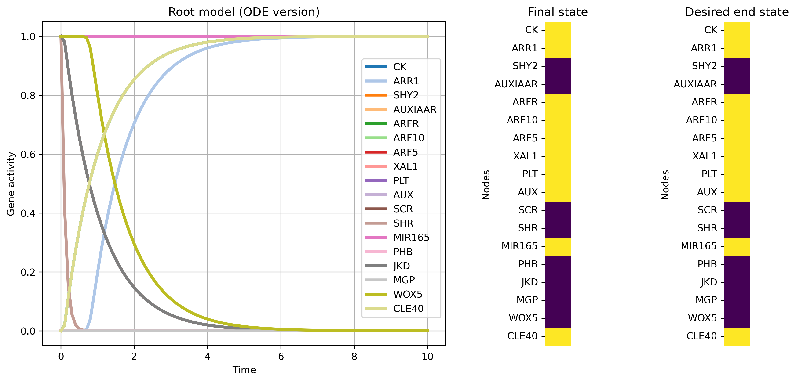{#vegmini1}

:::

:::{#exr-non}

## Biology
Use the model to predict the rest of the attractor transitions because of single variable changes. 
Are all attractor transitions possible, or are there preferred differentiation routes? Why do you think this is?
:::

:::{.content-visible when-meta="params.show_answers"}

  > **Answer** Not all attractor transitions are possible by single variable changes. This is because the regulatory
  > interactions in the model constrain how this perturbation is interpreted, and with it the differentiation 
  > trajectories (think of the landscape metaphor).

:::

## References
