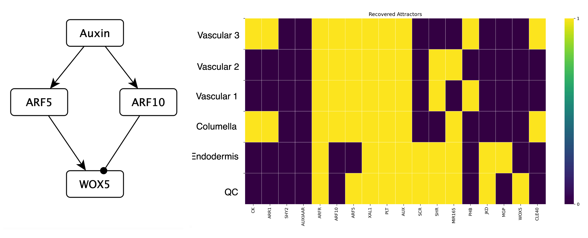
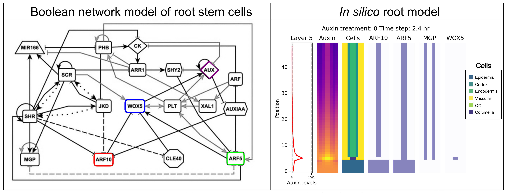
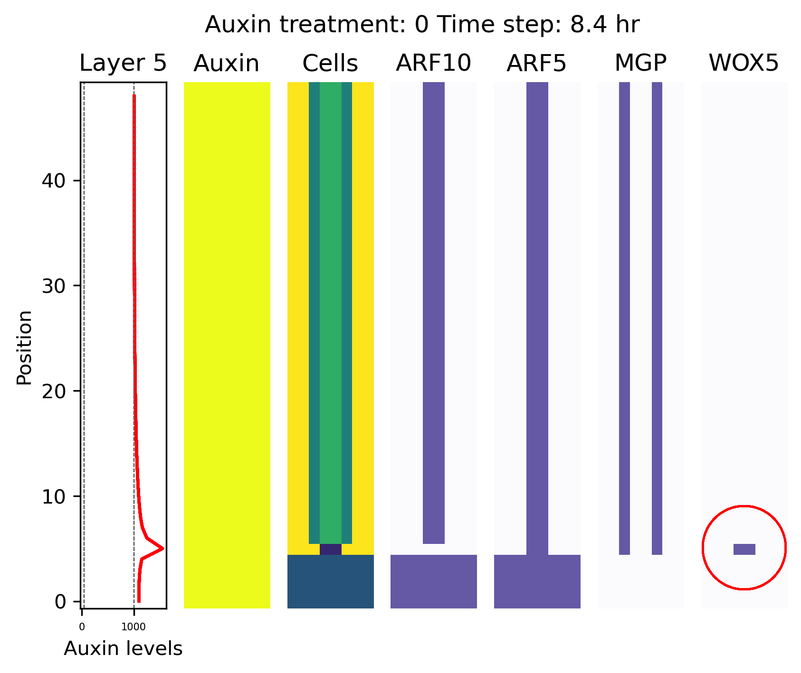
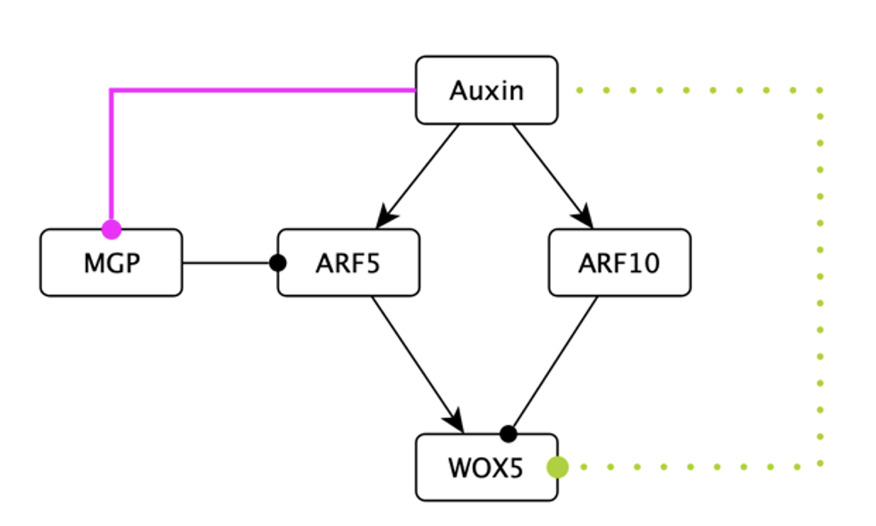
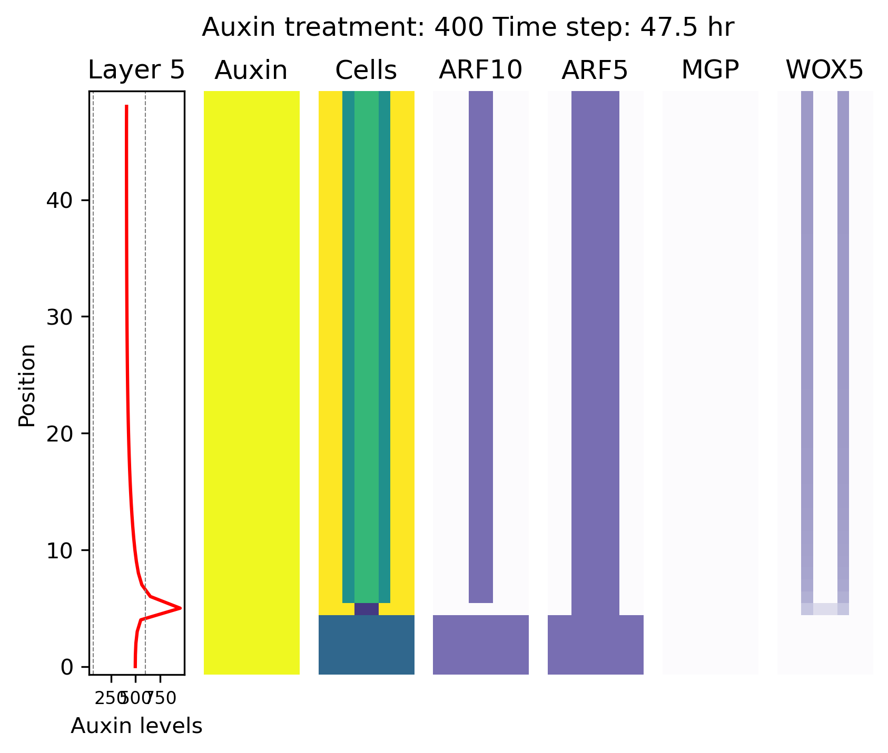
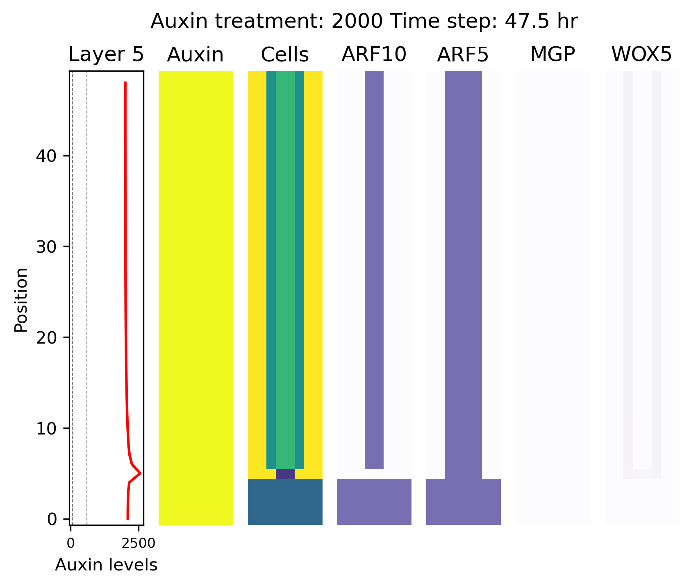
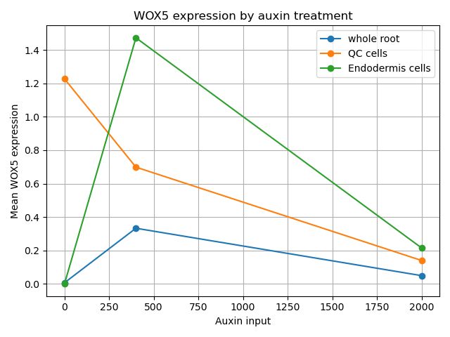

---
params:
  show_answers: true
---

# Gene regulation in space

## Auxin regulates *virtually* all aspects of plant development {.unnumbered}

In this practical you will study the effects of auxin, a plant hormone, on gene 
regulation in the root. Auxin is a hormone that is virtually involved in all 
developmental processes in plants, from how the plant embryo is patterned, how the 
organs in flowers are determined, the spatial disposition of leaves, among many 
many others. In each context, auxin triggers very specific responses, posing the question 
of how is it that the same molecule can trigger so many different responses. This 
specificity can be explained by the underlying regulatory networks. 

The auxin signalling pathway activates transcription factors, the auxin response 
factors (ARFs), which regulate gene expression in response to auxin. Arabidopsis 
has 23 genes coding for ARFs, some regulate gene expression positively and others 
negatively, they can also form protein complexes with other transcription factors, 
and important for this practical: they **are expressed in different tissues**. It 
is this diversity in transcription factors activity and expression, which in part 
explains how auxin regulates so many different aspects of plants

## Auxin activates and represses the expression of WOX5 in the root {.unnumbered}

Plant root growth is driven by the activity of stem cells housed in a niche at the root tip.
These stem cells self-renew and produce new cells, acting as a "growth engine". 
A subset of these cells express *WOX5*; these cells are really important as they maintain 
the stem cell niche. WOX5 is regulated by several factors, and network models help 
us understand how. Researchers have found paradoxical results regarding how auxin 
regulates WOX5: some experiments show that auxin promotes its expression, 
while others found it is repressed (Figure 1). 

{#vegmini1 width=130%}

In the previous practical we studied a Boolean network model of the root, in which
Auxin does this opposite regulation through different ARFs (Figure 2). Here we are
going to use this model in an *in silico* root model to explain the strange experimental
results in Figure 1.

## The network model {.unnumbered}

In the Boolean model WOX5 is regulated positively by ARF5, negatively by ARF10, and 
negatively also by CLE40. Both ARF5 and ARF10 are auxin response factors, activated 
by auxin.

<center> $WOX5_{t+1} =NOT$ $ARF10$ $AND$ $ARF5$ $AND$ $NOT$ $CLE40$ </center>
<br>
The expression of ARF5 and ARF10 is regulated by other transcription factors, 
causing them to be expressed in specific cells of the root as described by the
attractors recovered by the model (see Figure 3). 

{#vegmini1 width=100%}

Notice how the attractors differ in their expression of ARF10 and ARF5, and how 
the QC attractor is the only with the following combination: ARF5 active, ARF10 
inactive, CLE40 inactive; therefore allowing for WOX5 expression


Here you will explore whether this is relevant to understanding the 
auxin–WOX5 experimental paradox. For this you will use an *in silico* root model in which 
each cell carries a copy of the Boolean network initialized in a particular 
attractor

## The root model {.unnumbered}

Today you will use a multicellular model that simulates the cells of a root tip 
(Figure 3, right). To build this model we use classes. We create a class `Cell`, 
and a class `Tissue` that is made up of `Cells`. The `Cells` are arranged in 
layers to model the 8 tissue layers of the root, and initialized in the attractor 
corresponding to their position.The model simulates the transport of auxin from 
cell to cell, where their cell type defines the direction of polar auxin transport. 

In figure 3 (right) you can see the output of the model showing the distribution
of auxin in the middle cell layer, and different properties of `Cells``: auxin 
levels (log), the cell types (attractor initialized), and gene expression 
(in the figure we see only ARF10, ARF5, MGP and WOX5). 

{#vegmini1 width=130%}

### Files 
Download the python files from <https://github.com/moneralee/UU_Modeling-Life-course-2026/tree/main/WC08-Cell-differentiation_II>.  
You will find: 

#### WC08Cell.py {.unnumbered}
The class `Cell` is defined here.

<u>Attributes:</u> 

A `Cell` position is defined by `ypos` and `layer`; 

`auxin` stores the current auxin level and `auxinhelper` is used for the transport simulation;

`cell-type` is predefined based on their position (1-QC, 2-Columella, 3-Endodermis, 
4-Vascular, 5-TD, 6-Epidermis, 7-Cortex); 

`cell_state` is an array 
with the expression of each node of the network, which are modelled as individual
attributes: `CK`, `ARR1`, etc. 


<u>Methods:</u> 

`__init__` is used to initialize the cells; 

**`root_ode`** defines the ODE network (you will need to change this during the practical); 

`update_network_state` is used to solve the network; 

`update_cell_state` that updates the value of the genes (`Cell`'s attributes) based on the output of `update_network_state`.

#### WC08Tissue.py {.unnumbered}
The class `Tissue` is defined here. 

<u>Attributes:</u> A `Tissue` is composed of 50 cells in each layer (8). 

<u>Methods:</u> 

`load_state` reads a file with an initial condition (`initial_tissue_state.json`)
with cells arranged in cell files and rows, and their attractors are predefined based on how 
these cell types are organized in a root. 

`add_cell` adds cells objects to tissue. 

`get_cell` finds the cell in a given position in the matrix (useful to find the immediate neighbors
of a cell). 

`update_networks` updates the networks in each cell of the tissue (by 
calling the method `cell.update_network_state`). 

`Auxin_Passive_Transport` simulates 
the passive diffusion of auxin between neighboring cells (using the `get_cell` function). 

`Auxin_Active_Transport` simulates the active transport of auxin taking into account their 
cell type that determines the direction of the transport; This is a very large function 
because it checks the cell type of each cell in a cell layer. 

`Auxin_Source_Decay` auxin enters the root from the upper central cell, and decays 
in all cells. `visualize` creates 
the plot of the tissue. 

#### WC08_Root-tissue-model.py {.unnumbered}
The main file of the model. It defines the parameters, and the `simulate_development` 
function that uses the methods from the `Tissue` and `Cell` classes to 1) update the 
cell networks using `tissue.update_networks`, 2) simulate active auxin transport using 
`Auxin_Active_transport`, 3) simulate passive auxin transport using `Auxin_Passive_Transport`, 
4) update auxin input and decay with `tissue.Auxin_Source_Decay`, 5) and uses
`tissue.visualize` for the output plot of the model. Run this file, and if the 
plotting updates too slow increase the value in `plt.pause(1)`. 

#### initial_tissue_state.json {.unnumbered}
This is the initial condition of the model defining how cells are organized in a tissue, 
their attractors, and the auxin distribution.


## Questions 

:::{.content-visible when-meta="params.show_answers"}

  > **Answer** Look at `WC08_Root-tissue-model-answers.py` and `WC08Cell_answer.py` for the answer code :) 
  
:::

:::{#exr-non}
## Algorithmic thinking

Study how the model uses the different functions to simulate gene regulation and 
auxin transport in the root. 

Make a plain-language description, pseudocode, or flowchart using pen and paper 
of how the model works. What are the algorithmic steps you would take if you want 
to simulate the treatment of roots with auxin? 

:::

:::{.content-visible when-meta="params.show_answers"}

  > **Answer** To simulate the auxin transport first we need to find the neighbors 
  > of a given cell (function `findNeighbors`), and then calculate how much auxin should they 
  > exchange based on how much auxin they have (matrix `auxinGrid`) and what are their cell 
  > types (matrix `cellGrid`). The function `auxinTransport` does this; this function is called 
  > every timestep. 
  >
  > Next, to update the gene regulatory network we iterate over each cell of the simulation 
  > (for $x$, for $y$, as these are the dimensions of the grid) and store the value each element 
  > of the network (e.g. matrixes `WOX5grid`, `CKgrid`, etc.) into a `cellState` vector. `cellState` is 
  > used to solve the network (`rootNetwork`), whose output needs to be filled in again in 
  > the grids. We need to perform this every 10 timesteps, so we should make this inside a 
  > conditional statement (`if`). 
  > 
  > The above steps should be inside a for loop to iterate for as many timesteps as we want to simulate.
  
  > pseudocode: 
  > 
  >     Initialize auxinGrid
  > 
  >     Initialize cellGrid
  > 
  >     Initialize WOX5grid, CKgrid, ...   # all GRN variable grids
  > 
  >     For t in Timesteps:
  > 
  >        For each cell (i, j) in the grid:
  > 
  >         neighbors = findNeighbors(i, j)
  > 
  >         auxinGrid = auxinTransport(auxinGrid, cellGrid, i, j, neighbors)
  > 
  >         If (t % 10 == 0):    # update every 10 timesteps
  > 
  >             For each cell (i, j) in the grid:
  > 
  >                 cellState = [WOX5grid[i][j],CKgrid[i][j],...   # add other network components]
  > 
  >                 updatedState = rootNetwork(cellState)
  > 
  >                 WOX5grid[i][j] = updatedState.WOX5     # Write updated values back into the grids
  > 
  >                 CKgrid[i][j]   = updatedState.CK
  > 
  >                    ...            # repeat for others
  > 
  > 
  
:::

:::{#exr-tur}

## Biology & algorithmic thinking

Now let's use the model to simulate the auxin treatments from the experiments in Figure 1. 
To simulate an auxin treatment change the value of $auxininput$ in `Root-model-Auxin.py`. 
Try values of 10, and 100 and 1000 (nM). This increases auxin levels in all cells by the 
same amount. You can run one treatment at a time, or make a for loop and run the three 
in one go. 

- How does auxin treatment affect WOX5 gene expression in the root? 

- Does the model output correspond to the transcriptional reporter of WOX5 
shown in Figure 1? 

- Do you see activation or repression as reported experimentally? (You can
visualize different genes by changing the genes in `tissue.visualize`.

**Notice the simulation creates an output folder with png images.**


:::

:::{.content-visible when-meta="params.show_answers"}

  > **Answer** The levels of auxin increase in the cells of the root model (as visualized 
  > with the plotting function), but the expression of WOX5 remains the same. This means, 
  > the model in its current form, cannot explain the observations from the experiments. 
  > Yet, we can use this model to test hypotheses and test how we can recover such behaviours (Figure 1).
  
  {#vegmini1 width=100%}

:::


:::{#exr-tur}

## Biology & algorithmic/mathematical thinking

The model does not yet reproduce the experiments. Yet, we can use this model to test 
hypotheses and aim to recover such behaviours (Figure 1). Let's implement the following two hypotheses:

{#vegmini1 width=60%}

Modify the equations for MGP and WOX5 in the `root_ode` method of the `Cell` class. 

- For MGP, multiply its production term, that implements its logical rule, by an inverse 
sigmoid of auxin ($Km = 45$): <span style="color: magenta;"> $\frac{45}{45+auxininput}$ </span>

- Similarly, add a negative regulation by auxin to the WOX5 equation
($Km = 1000$).

Run control and auxin treatments with (i) updated MGP, (ii) updated
WOX5, and (iii) both updates. Use the plotting functions to plot the final timepoint. 

It is also interesting to run the timecourse, by plotting every 10 steps.

Do you now see the differences reported by experimentalists?

::: {.callout-note collapse="true"}
## Answer: look if you are stuck
``` python
    # Auxin regulates MGP. These has an indirect positive effect on ARF5. 
        dMGP = (200**2/(200**2+(auxininput+AUXIN)**2))*sigmoid(w_MGP,h) - (decayrate * MGP)
    # Auxin represses WOX5 at *very* high levels - most hormones exhibit this dosage dependent effect.
        dWOX5 = (700**2/(700**2+(auxininput+AUXIN)**2))*sigmoid(w_WOX5,h) - decayrate*WOX5  
````
:::
:::

:::{.content-visible when-meta="params.show_answers"}

  > **Answer** Yes, the model with both hypothesis can reproduce the experimental 
  > observations. 
  > The hypothesis regarding MGP regulation enables ectopic ARF5 expression in the 
  > endodermis, needed to allow for WOX5 expression in these cells. The second 
  > hypothesis is to shut down expression in the QC cell, and gradually in the 
  > rest of the cells.
  > The model suggests that the effects of auxin on WOX5 expression might 
  > depend on the **cell type** and on the **dosage** of the treatment. 
  > Auxin treatment = 100 induces WOX5 expression in the endodermis.
  > Then, for auxin treatment = 1000 this incremeber still takes place, albeit  
  > reduced. If we focus on the QC we can see that the expression of WOX5 is gradually 
  > reduced.
    >
    {#vegmini1 width=100%}
    
    {#vegmini1 width=100%}
  
:::


:::{#exr-tur}

## Biological interpretation

Regarding the auxin treatment = 400: 

- Why do different cells of the root respond differently to auxin treatments? 

- Why does auxin regulation of MGP do? (Look at the network...)

- Why does expression of WOX5 occur mainly in "upper" cells and repression in the cells at the bottom?

:::

:::{.content-visible when-meta="params.show_answers"}

  > **Answer** 
  > 
  > - Cell differentiation causes the differences in ARF10 and ARF5 gene expression 
  > in specific cells of the root. This results in only some cells in the root being 
  > competent to express WOX5. 
  >
  > - MGP represses ARF5, enabling WOX5 expression in the endodermal cells,
  >
  > - Because auxin is distributed in a gradient so the cells at the tip will reach the repressive levels before the "upper" cells.

:::

:::{#exr-tur}

## Algorithmic thinking

Experimentally scientist perform RT-PCR experiments of the whole root and check gene 
expression changes. Here, we are going to compare how our interpretation of auxin
changes if we check gene expression in wht whole root and in specific tissues. 

Let's use the model to do an in RT-PCR *in silico* analysis. Run the auxin treatments
0, 400 and 2000, and in each case calculate 1) the average WOX5 expression for all the
cells in root, for only the cells in the QC position, and only the endodermis cells. 

Tip: types are a `Cell` attribute.

- Which case represents better how WOX5 is regulated in the root tip? Why?

- What is the overall effect of auxin treatments in the root tip? Considering that
the root is a mixture of many cell types, which cells best represent the
plotted values?

:::

:::{.content-visible when-meta="params.show_answers"}

  > **Answer** What portion of the root we sample changes completely our perception 
  > of how auxin regulates WOX5. If we sample the whole root we get the impression 
  > that WOX5 is induced (and that is true for the endodermis cells). Yet, if we sample 
  > the QC cells we notice auxin represses WOX5 expression, while sampling only 
  > endodermal cells only shows activation. 
  >
  > In a way, both results are correct, and reveal how the effects of auxin are 
  > dependent on the spatial context. Moreover it shows how difficult it is to draw conclusions 
  > from this sort of experiments when sampling an organ that contains a mixture of 
  > cell types. Nowadays experimentalists can isolate individual cells (with 
  > FACS cell sorting, or with tools like laser capture microdissection microscopy)
  > but this is very laborious. Thus, sampling the whole tissue is the easier option, 
  > but we have to be aware that tissues are composed of many cell types, and each 
  > may respond differently!
  > 

   {#vegmini1 width=100%}
  
  
:::


:::{#exr-tur}

## Biology & algorithmic thinking

Changes in WOX5 expression depend on tissue context and auxin dosage.
Simulate a range of auxin treatments from 0 to 750, and save only an image
for the final timestep (this will make the simulation faster, and you don't
need to see every timestep).

Can you now explain the auxin–WOX5 paradox? What mechanism do you
propose?

:::

:::{.content-visible when-meta="params.show_answers"}

  > **Answer** It is clearly dependent on the auxin dosage and the cell type. 
  > Which aligns with the fact that this hormone is implicated in so many different 
  > processes in plants. The underlying gene regulatory networks, and cell 
  > differentiation, enables a diversity of responses.   
  
:::

:::{#exr-tur}

## Biology & conceptual thinking

- Perform an *in silico* intervention to alter WOX5 dosage responsiveness to auxin. 
For example, what would it take to enforce its continuous expression, or to block 
completely its induction in the endodermis. Check the feasibility of your intervention 
with the model. 

- How would you test these model predictions experimentally?
:::

:::{.content-visible when-meta="params.show_answers"}

  > **Answer** This is an open question. Feel free to test your ideas with the model
  and discuss with us your results :)
  
:::

:::{#exr-tur}

## Biological thinking 

All models are wrong, but some are useful. The model we studied today offered us a 
mechanistic insight into the paradoxical auxin responses. Yet, (to make things more 
fun), the original experiments used different auxin *analogs* and other molecules 
which are transported very differently between cells: NAA (transported independently 
of PINs), IAA (PIN-transported), and NPA (blocks PINs, increasing auxin in the 
tip). 

How does this information change your conclusions? 

How would you modify the model to account for these differences?
:::

:::{.content-visible when-meta="params.show_answers"}

  > **Answer** Open question. This will be a mini project!  🌱
  
:::

## References

- @mahonen2014plethora
- @ding2010auxin
- @shamir2016snapshot
