---
params:
  show_answers: false
---

# Turing patterns, repetitive patterning
  
## {.unnumbered}
A foundational work in Theoretical Biology is Alan Turing's paper 
*"The Chemical Basis of Morphogenesis"* (@turing1990chemical). In this work, 
Turing mathematically demonstrates a plausible mechanism whereby a 
reaction-diffusion system can lead to the formation of a spatially-patterned 
solution in steady state. Mathematically and conceptually, Turing’s key 
innovation was considering diffusion-driven instability. That is: A 
non-patterned steady state solution becomes unstable in the presence of 
diffusion, leading to the formation of a spatially patterned state.

Turing-type patterns emerge when a system exhibits short-ranged activation 
and long-ranged inhibition. The most well-known realization of a Turing 
reaction-diffusion system is the combination of a slow-diffusing activator 
and fast-diffusing inhibitor. Many more examples exist which can be reduced 
to a mathematically equivalent form. In this practical, we will explore a 
3-component Turing system developed by Raspopovic and coauthors to explain the 
patterning of fingers on the paws of mice (@raspopovic2014digit).

::: {.columns}


::: {.column width="60%"}
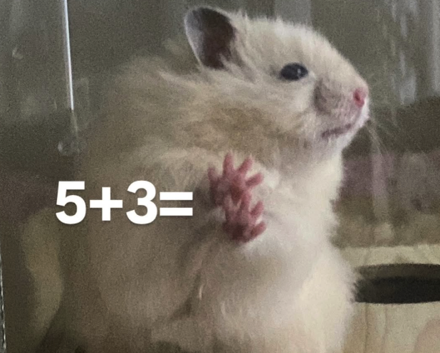{#vegmini1 width=40%}
:::
::: {.column width="60%"}

<!-- -In this practical you will work with a total of 3 different python codes. 
Please note that each code simply differs by an extension or modification 
from the previous code, so that in the end you will have a long script that 
performs all the steps in one go.-->
:::
:::
------------------------------------------------------------------------

## Equivalence of Turing models

The model proposed by Raspopovic et al. for generating Turing patterns underlying 
limb bone modeling consists of 3 instead of 2 interacting variables. We will 
refer to this model as “BSW” model, as it represents interactions between the genes
Bmp, Sox9, and Wnt.

:::{#exr-tur}

## Conceptual thinking 

Study the schemes below. The arrows represent activating or inhibiting interactions, 
while the wavy lines represent diffusion of components. Simplify this 3-variable 
model scheme into a 2-variable model scheme (just by drawing the interactions, 
no need to write equations) and explain how it satisfies the Turing conditions 
discussed in the lecture. Remember that for Turing patterns we need an activator 
an inhibitor. 

Hint: In a 2-variable system the activator needs to be a single autoactivating molecule. 
When we have more variables, the positive feedback can be achieved differently 
(indirectly). So think which two variables would be logical to combine into one 
to get a 2-variable model..

::: {.columns}


::: {.column width="40%"}
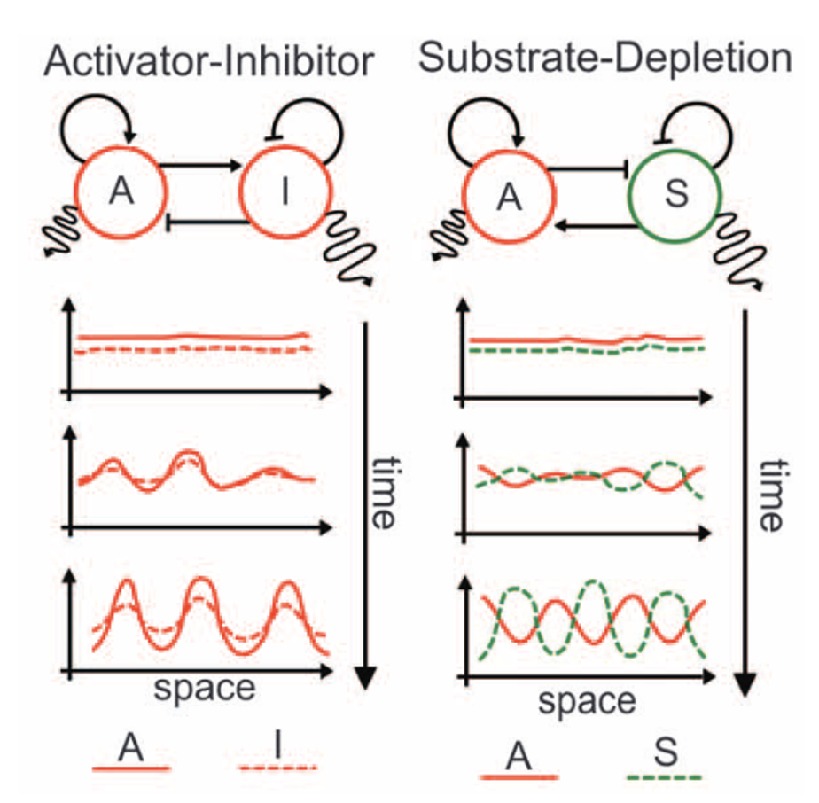{#fig-turing}
:::

::: {.column width="60%"}
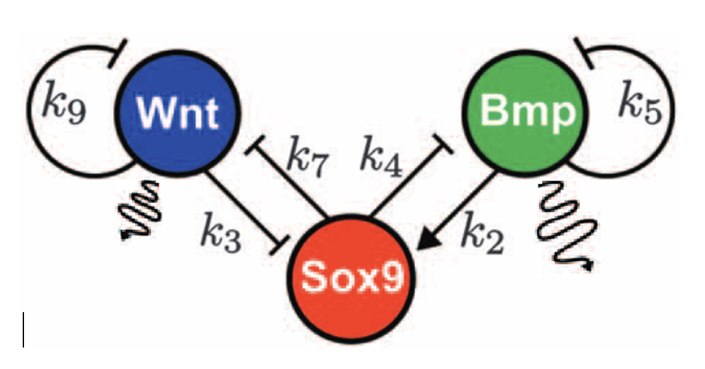{#fig-wntbmpsox }
:::

:::

:::


::: {.content-visible when-meta="params.show_answers"}
> **Answer** 
> “Fuse” the Sox9 and Wnt nodes to get Substrate-Depletion model <br>Fig. 6.1 Right).	
> Sox9 inhibits Wnt, which in turn inhibits Sox9: this can be summarized as a
> self-activation <br>b). In this reduced scheme, the Wnt self-inhibition arrow  
> would be part of the self-activation. Then, Wnt slow diffusion -> Sox9 slow 
diffusion.<br>
> Turing instability requires short-range activation and long-range inhibition. 
> In the substrate-depletion model, the increase of the slow-diffusing activator 
> A is constrained by the local loss of fast-diffusing substrate S. Around an 
> A-enriched domain a halo of S will form, which will induce nearby A domains 
> to grow, generating the alternating spatial pattern.<br>
> In the BSW model, Sox9 indirectly locally self-activates by inhibiting its 
> slow-diffusing inhibitor Wnt, but the growth of Sox9 domains is constrained 
> by depletion of the fast-diffusing Bmp (playing the role of substrate in this 
> model). Around Sox9-enriched domains a halo of Bmp will form and induce the 
> generation of more Sox9 domains in the surroundings.

:::


## Patterning in a fixed domain size

The code in the script `WC05_digits-square-START.py` simulates the BSW model in a 
2D-square tissue of constant size. This setup can be considered as a small 
region of a large Petri dish in which mesenchymal cells have been plated with 
the correct chemicals to undergo morphogenesis (bone formation, FigureS3 @raspopovic2014digit).

:::{#exr-tur}

## Biology

Play with the parameters, for example changing $k4$ (Sox9 effect on BMP), $k7$ (Sox9 
effect on Wnt), or changing how much faster is Bmp diffusion compared to Wnt 
diffusion. Change one parameter at a time and observe the effects on the patterning. 
Change the values in one direction and the other, to confirm it produces the 
opposite effect. 

What effects on the pattern wavelength do you find? Are there changes in two 
parameters that produce the same effect? Why?

**Let op!**: Make sure to make small changes for $k4$ and $k7$. If things start 
blinking wildly, or go blank, you are watching numerical errors rather than real 
outcomes. When increasing Bmp diffusion you may need to reduce the time step for 
integration $dt$. 

:::

::: {.content-visible when-meta="params.show_answers"}

> In general, all three components follow similar trends in terms of concentrations 
> as any impact on one component will affect the others via feedbacks. Then, for 
> simplicity here we only show Sox9 patterns:

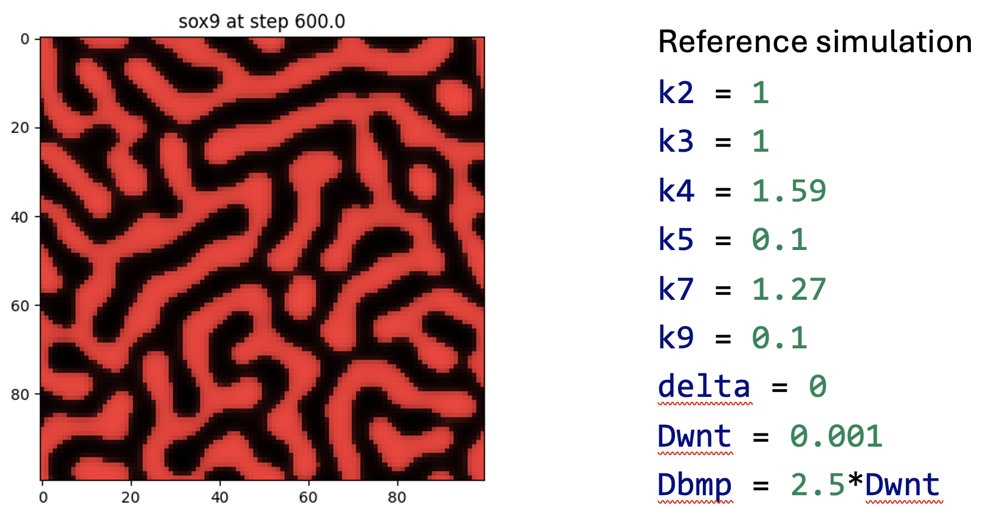{#vegmini1 width=40%}

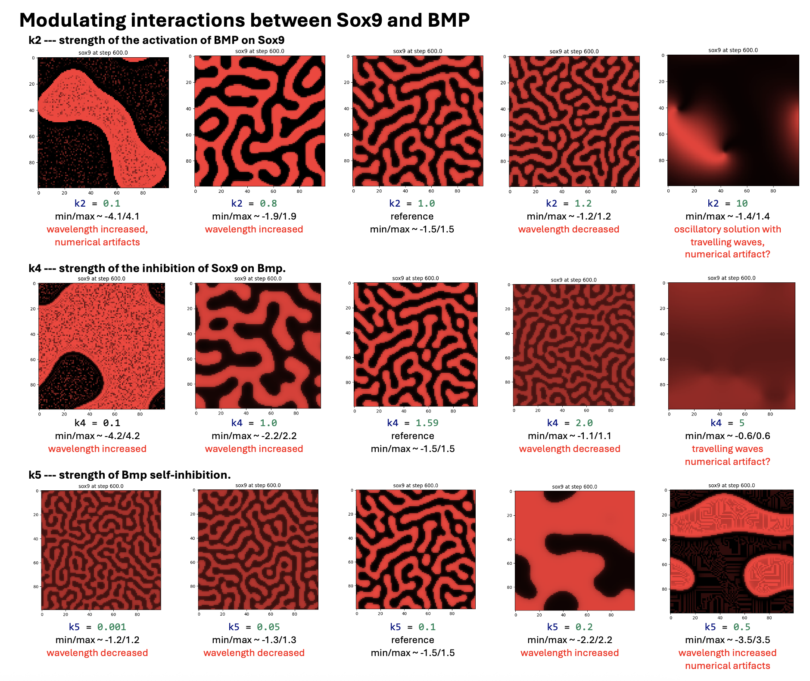

> Increasing or decreasing the parameters $k2$ and $k4$ has the same effect 
> on the pattern. <br>
> With increased Sox9 activation (high $k2$) a lower amount of BMP is sufficient 
> to get Sox9 to increase which in turn inhibits both Wnt and Bmp. As a result, 
> the “peaks” are reached closer in space resulting in shorter lower amplitude 
> wavelengths. Similarly, when Sox9 inhibition of BMP is high (high $k4$) then 
> BMP peaks are lower, which means there is less Sox9 activation leading to 
> smaller amplitude peaks and hence shorter wavelength.
> 
> Conversely, if Sox9 activation by BMP is weak (low $k2$), then it takes more 
> BMP to build up to a peak, resulting in longer distance between peaks, and thus 
> longer higher amplitude wavelengths. When Sox9 inhibition of BMP is weak (low $k4$), 
> then it takes larger Sox9 domains to deplete BMP, resulting in longer higher 
> amplitude wavelengths.
> 
> If Sox9 activation ($k2$) or BMP inhibition ($k4$) are extremely strong, Sox9 
> locally depletes BMP faster than it can diffuse, which in turn leads to a reduction 
> in Sox9; this could explain local oscillations and travelling waves, though this 
> result should be verified with a better numerical scheme.
> 
> Changing BMP self-inhibition ($k5$) has the opposite effect as Sox9 activation 
> ($k2$) and BMP inhibition ($k4$). BMP self-inhibition restricts the size of BMP 
> domains. Stronger self-inhibition (high $k5$) means small pockets of BMP are 
> destabilized and Sox9 regions grow until the point that they completely deplete 
> the local BMP, resulting in larger higher amplitude peaks. Vice-versa, 
> reducing BMP self-inhibition (low $k5$) allows BMP peaks to more easily form, 
> leading to shorter pattern wavelengths. Unlike the other two parameters, 
> this reduction only happens up to a point, as the other feedback interactions 
> take over. 

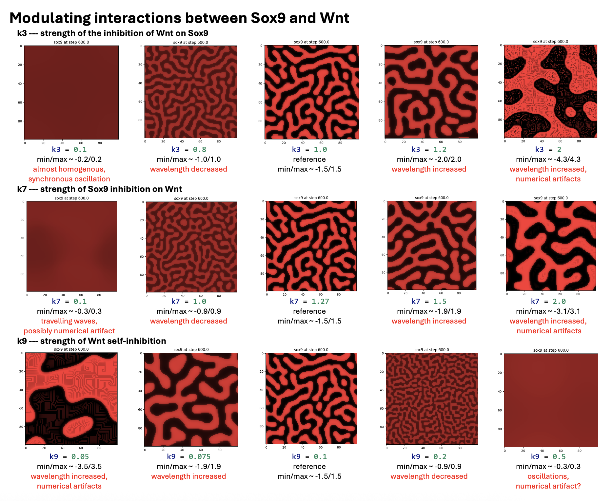

> Increasing or decreasing the parameters $k3$ and $k7$ has the same effect on the 
> pattern. When Wnt inhibition of Sox9 is increased (high $k3$) or Sox9 inhibition 
> of Wnt is increased (high $k7$) the cross-inhibition of both variables is stronger, 
> meaning they will tend to create larger exclusion zones which translates as longer 
> higher amplitude wavelengths. When Wnt inhibition of Sox9 is decreased (low $k3$) 
> or Sox9 inhibition of Wnt is decreased (low k7) smaller regions can coexist, 
> reducing the wavelength and the amplitude. Even lower cross-inhibition means the 
> regions overlap, and small time delays could lead to oscillations, although this 
> should be verified with a numerically better scheme.
> Wnt self-inhibition ($k9$) limits the growth of Wnt domains. When self-inhibition 
> is strong (high $k9$) Wnt domains shrink and therefore the wavelength is shorter 
> with lower amplitude. Even stronger self-inhibition leads to overlapping domains 
> and similar oscillations as observed for low $k3$ and low $k7$. Vice-versa, a 
> decrease of Wnt self-inhibition (low $k9$) allows larger patches of Wnt to form, 
which increases the wavelength and the amplitude.

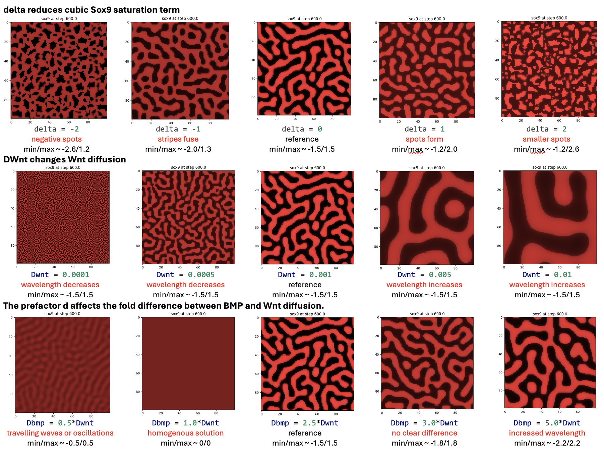

> The equation for Sox9 includes a “saturation term” in the form of a negative cubic 
> power of Sox9, which means that effectively there is Sox9 self-inhibition in the 
> model. The parameter $delta$ multiplies a quadratic Sox9-dependent term in the 
> equation for Sox9, which by default is set to 0. A positive delta effectively 
> means that Sox9 has a self-activation term that counteracts the self-inhibition 
> by the cubic saturation term, whereas a negative delta means the Sox9 self-inhibition 
> is stronger. 
> 
> Introducing a stronger Sox9 self-activation ($delta$ > 0) increases the amplitude 
> Sox9 domains. Due to this local strong increase in Sox9, there is also a local strong
> depletion of BMP which prevents stripes from elongating, resulting in a spot pattern.
> 
> Introducing a stronger Sox9 self-inhibition ($delta$ < 0) reduces the amplitude 
> of Sox9 domains. There is thus less BMP depletion which enables stripes to elongate 
> and fuse more easily.<br>
> Wnt and Sox9 are cross-inhibitory, and thus their domains will compete. Lower Wnt 
> diffusion means Wnt domains form locally, leading to a reduced wavelength. Vice-versa a 
> higher Wnt diffusion means that Wnt spreads away from Sox9 domains enabling them to 
> expand ultimately resulting in longer wavelengths. Note that since BMP diffusion scales 
> with Wnt diffusion, both parameters were changed at the same time.<br>
> The ratio of diffusion speeds defines the size of the Turing space. As the diffusion of 
> BMP is set equal to that of Wnt, the homogenous solution becomes stable. Reducing the
> diffusion of BMP further leads to travelling waves or oscillations. This is because a 
> slow (or stationary) BMP is in a local negative feedback loop with Sox9, which results 
> in oscillatory behavior. The establishment of Wnt domains around the oscillating Sox9 
> regions is also oscillatory.<br>
> Increasing BMP diffusion allows to more effectively “feed” Sox9 domains, which leads 
> to a subtle increase in the wavelength and amplitude.

:::


------------------------------------------------------------------------

## Patterning in a growing domain size

Besides parameter values, the pattern that emerges from a Turing system is also 
strongly influenced by initial conditions, and the size and shape of the domain 
where reactions and diffusion happen.

Let's modify the code to add tissue growth in the proximo-distal (body to limb) 
direction. Growth is controlled by a growth rate $vi$, which is currently set 
to zero. The tissue is initialized at its maximal size ($nx$, $ny$), so 
we also need to make it smaller. See below how: 

::: {.callout-note collapse="true"}
## Tissue growth implementation

``` python
# Horizontal growth rate
vi = 0.0                     # Let op: make it > 0 

# Initial condition parameters for a square tissue domain
# Horizontal: Start on left side of the nx*ny box
Lx0 = nx                    # Let op: Tissue is initialized at max size, make it 30
max_domain_horizontal = nx # Stop growing once this reached
# Vertical: Start in middle of the nx*ny box
Ly0 = ny                    # Let op: Tissue is initialized at max size, make it 30
max_domain_vertical = ny # Stop growing once this reached

```
:::


:::{#exr-tur}

## Biology

-   Study the code to understand what it does.\
-   Increase the horizontal growth rate $vi$ in small increments (try: 0.01, 0.05, 
0.1, 0.2, 0.5) and study what happens to the pattern. Explain why you think this happens.

**Note:** Increase the $totaltime$ parameter to 5000 when using growth rate of 0.01.
:::

:::{.content-visible when-meta="params.show_answers"}

> **Answer** At low growth rates, the pattern forms stripes parallel to the growth 
> direction. As the growth speed increases, the alignment shifts to stripes perpendicular 
> to the growth direction. When growth is slow, the “new domain” added by growth is too 
> small to fit a Turing wavelength. As a result, the existing pattern gets extended into 
> the new parts. When growth is fast, the “new domain” added by growth is sufficiently 
> large to fit a Turing wavelength, which becomes the selected mode. Additionally for 
> faster growth, the diffusion/growth ratio is now lower making it harder to simple 
> extend the existing pattern from diffusion of the old cells that previously made up 
> the boundary.

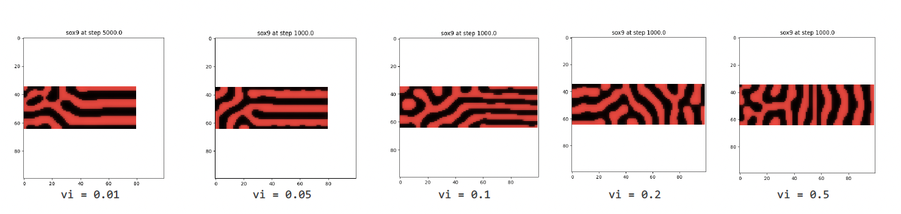

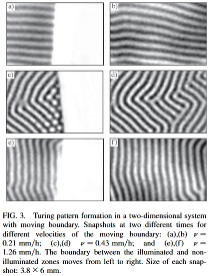{width=40%}


:::

------------------------------------------------------------------------

## Patterning along two growth axes

In reality, the limb bud grows in both the proximo-distal and anterior-posterior 
direction. You can implement this by modifying the value of the growth rates 
$vi$ for proximo-distal growth and $vj$ for anterior-posterior growth.

:::{#exr-tur}

## Biology

Play with the relative size of these growth rates and study what happens. Compare 
the order of appearance of stripes to the experimental data in the paper (see 
Figure3F in the Raspopovic paper @raspopovic2014digit).

:::

:::{.content-visible when-meta="params.show_answers"}

> **Answer** 
> 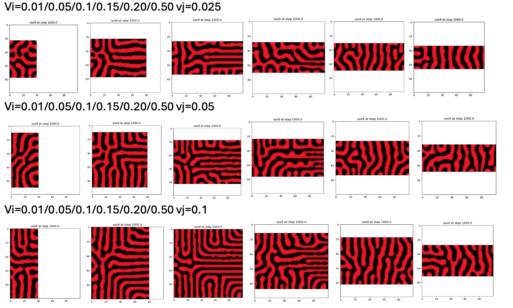{#vegmini1 width=140%}
> As in the previous question, the rate of growth influences whether stripes grow 
> parallel to or perpendicular to the growth boundary. Also as before, slow horizontal 
> growth promotes horizontal stripes ($vi$<=0.1), and when this becomes faster stripes 
> reorient to become vertical. However now, if we add vertical growth and it is not
> small enough relative to the horizontal growth ($vi$=0.1, $vj$=0.8), above and below 
> our horizontal stripes now we get vertical stripes, and these domains are larger 
> the faster vertical growth is relative to horizontal growth. So to get ok-ish patterns
> (remember, we want to model fingers!) we need horizontal growth not too fast, and 
> vertical growth to be slower. These results are consistent with horizontal growth 
> of the “paddle” being faster than vertical growth. 
> Another indication that our model represents the actual patterning of the paddle is
> that the middle horizontal stripes that appear earlier than the outer ones (in our 
> simulations where we have horizontal and vertical stripes) are similar to what 
> we see in the paper in Fig 3F. 
> Still interestingly, if you put $vj$=0.2 and $vi$=0.1 you promote initially vertical 
> and later on horizontal stripes. This is an effect of the growtn in the vertical 
> direction hitting the boundaries of the domain first, and then continue to grow 
> slowly in the horizontal dimension at a rate that allows for the extension of
> horizontal stripes.

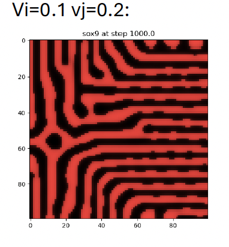{#vegmini1 width=40%}
:::

------------------------------------------------------------------------

## Making a virtual tissue grow

Think about how tissue growth is implemented in the model.

:::{#exr-tur}

## Algorithmic and conceptual thinking 

 What is the default Sox9, Bmp and Wnt value of the newly added tissue when it 
 grows? Is their concentration elsewhere in the tissue changed?

Do you think this approach is reasonable to model biological growth of a tissue? 
Explain why/why not.

*Hint:* Think about it from the perspective of a growing cell containing a number 
of molecules “X”.\
If the cell increases in volume and does not produce/degrade X, what happens to 
the concentration of X?\
What would be the concentration of X in the two daughter cells if the cell divides?\
How would the situation change if X is constantly produced and degraded?

In the paper, @raspopovic2014digit create a “tissue growth map” (see their Figure 3A), 
which they use to map concentration values from one timepoint to the next using
interpolation-based transformations.

Inspired by this approach, the script `WC05_digits_square-Question5_interpolation-growing.py` 
implements a different growth function that uses bilinear interpolation to expand 
the tissue. Search for `# new addition relative to previous code` to help you 
find what is new in this code. 

Play around with the growth rate parameters and compare the results 
to what you found earlier. Do the patterns differ? If yes, how do they differ?

*Hint:* Try the supplementary script `supp_g__bilinear_interpolation.py` in the 
Supp folder to understand how interpolation-based growth works.

**For master students:** yet another way of implementing tissue growth would be 
to take cell division and inheritance of maternal state by the two daughter cells 
literal and implement this by new boundary cells copying the state of their direct
neighbors. Implement this alternative growth and see how this affects your results.

:::


:::{.content-visible when-meta="params.show_answers"}
> **Answer** 
> 
> - The default value of newly added tissue is 0, because the entire matrix is 
> initialized with 0s, and only a small rectangle corresponding to the initial 
> tissue domain is filled with random values and then updated based on the equations. 
> When growth happens, the tissue domain extends to cover new parts of the matrix 
> that were not included in the initialization. Extending the edges into 0-valued 
> territory would be as if new, empty cells appear at the edges of the tissue, which 
> is not a reasonable approach to model limb bud growth.<br>
> - If a cell increases in volume without producing/degrading molecules “X”, then 
> the concentration of X will decrease as the cell increases in volume. Daughter 
> cells would have on average half the concentration of X as the mother cell. 
> If “X” is constantly produced and degraded (and the cell is a well-mixed environment) 
> then the concentration of X could be in quasi-steady state during growth. A growing 
> cell would maintain the same concentration of X over time. When the cell divides,
> both daughter cells would inherit the same concentration of X as the mother cell had. 
> Assuming the latter scenario is more likely, then growth of a tissue should work by
> “stretching” the values of the growing parts. (Some tissues actually do grow only
> at the edges, but even there we would expect the newly added “territory” to be made 
> from previous cells and therefore still inherit their concentrations.)

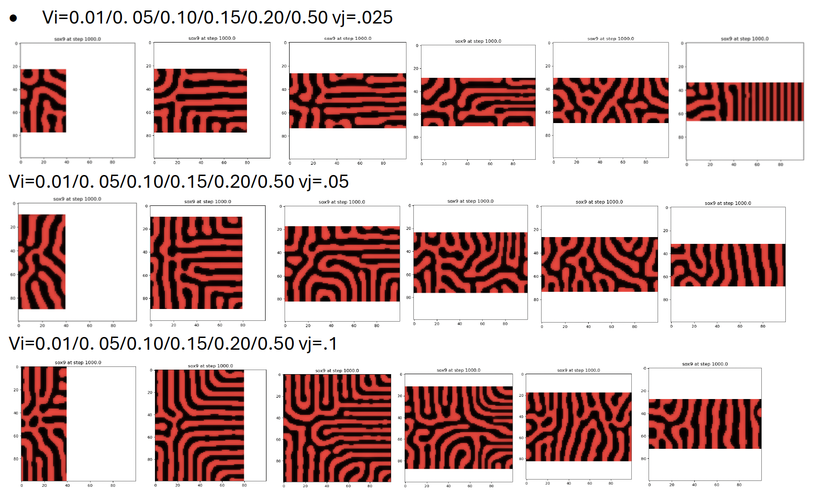{#vegmini1 width=140%}

> The different growth appears to affect pattern formation, e.g for $vj$=0.01 the 
> pattern is still predominantly horizontal for 0.15, which was less so before. 
> In constrast for $vj$=0.05 and $vi$=0.15 pattern is mostly vertical whereas in other 
> growth regime it was still partly horizontal. Seems that transition from horizontal 
> to vertical stripes is thus modulated. So for low $vj$ it is easier to get horizontal 
> stripes.


:::

------------------------------------------------------------------------

## Spatial modulation of parameters k4 and k7

Let us now ignore growth and its role on orienting stripes for a while, and 
explore again the influence of parameters on the patterns. In reality, digits are 
patterned further apart at the distal end than at the proximal end, where they 
need to converge on a hand and wrist. This implies that the wavelength of the 
Turing pattern should not be constant along the proximo-distal axis. 

In Question 2 you probably found that the $k4$ and $k7$ parameters 
impact the wavelength of the Turing pattern. The authors speculate that the 
gradients formed by two genes (FGF and Hox) in the limb bud exert an effect on 
the Sox9-Bmp-Wnt patterning module through these parameters.

:::{#exr-tur} 

## Biology 

Let us implement exponential gradients of $k4$ and $k7$ across the tissue. 
We need to add three new functions, initialize the $k4$ and $k7$ gradients, 
change the function used for the reaction-diffusion simulation, and update 
the plotting to also show $k4$ and $k7$ gradients. Sounds like a lot, but it is 
not. Follow the instructions below to make the changes yourself:

::: {.callout-note collapse="true"}
## New functions: copy to the FUNCTIONS section of the code

``` python
def single_time_step(sox9, bmp, wnt,               # matrices with variables
                     Dbmp, Dwnt,                   # diffusion coefficients
                     k2, k3, k4, k5, k7, k9, delta # reaction parameters
                     ):
    """
    Solves a single time step of the reaction-diffusion simulation 
    using explicit forward Euler.
    The diffusion operator (Laplacian) is solved with a 5-point stencil.
    See also: 
    https://en.wikipedia.org/wiki/FTCS_scheme
    https://en.wikipedia.org/wiki/Five-point_stencil
    """
    # In this case, the domain boundaries are the full size of the matrix
    minx = 0
    maxx = sox9.shape[0]
    miny = 0
    maxy = sox9.shape[1]

    # DIFFUSION OPERATOR

    # Create a bigger matrix with one extra row and column on each side
    bigL_bmp = np.zeros((bmp.shape[0] + 2, bmp.shape[1] + 2))
    bigL_wnt = np.zeros((wnt.shape[0] + 2, wnt.shape[1] + 2))

    # Implement no-flux boundary condition
    # Fill the domain boundaries with the closest inner value
    # -> the gradient is zero -> hence no-flux boundary
    bigL_bmp[minx:maxx+2, miny:maxy+2] = np.pad(bmp[minx:maxx, miny:maxy], 1, mode='edge')
    bigL_wnt[minx:maxx+2, miny:maxy+2] = np.pad(wnt[minx:maxx, miny:maxy], 1, mode='edge')


    # Calculate the Laplacian

    # Create empty matrices for laplacians
    laplacian_bmp = np.zeros_like(bmp)
    laplacian_wnt = np.zeros_like(wnt)  

    # all indices shifted by one to account for extra row and column
    minX = minx + 1
    maxX = maxx + 1     
    minY = miny + 1
    maxY = maxy + 1

    laplacian_bmp[0:nx, 0:ny] = (bigL_bmp[minX+1: maxX+1, minY:maxY] + 
                                 bigL_bmp[minX-1: maxX-1, minY:maxY] + 
                                 bigL_bmp[minX  : maxX  , minY+1:maxY+1] + 
                                 bigL_bmp[minX  : maxX  , minY-1:maxY-1] 
                                 - 4 * bigL_bmp[minX:maxX, minY:maxY])
    
    laplacian_wnt[0:nx, 0:ny] = (bigL_wnt[minX+1: maxX+1, minY:maxY] + 
                                 bigL_wnt[minX-1: maxX-1, minY:maxY] + 
                                 bigL_wnt[minX  : maxX  , minY+1:maxY+1] + 
                                 bigL_wnt[minX  : maxX  , minY-1:maxY-1] 
                                 - 4 * bigL_wnt[minX:maxX, minY:maxY])
       
    # REACTIONS + DIFFUSION
    # Calculate the change in variables in step dt
    dsox9 = dt*( k2*bmp - k3*wnt - sox9**3 + delta*sox9**2 )
    dbmp  = dt*( (Dbmp/(dx*dx))*laplacian_bmp - k4*sox9 - k5*bmp )  
    dwnt  = dt*( (Dwnt/(dx*dx))*laplacian_wnt - k7*sox9 - k9*wnt )

    # Update the variables
    sox9 += dsox9
    bmp  += dbmp
    wnt  += dwnt

    return sox9, bmp, wnt


### Helper functions to create locally varied values of k4 and k7

def k4_local_Supp21C(k, xsize, ysize):
    """
    Call this function to reproduce the exponential variation
    in k4 parameter values in Supp. Fig. 21 C.
    """
    
    k4local = np.zeros((xsize, ysize))

    # Parameters to reproduce panel C.
    min = 1 #minimum value of k4                    Question6
    max = 1 #maximum value of k4                    Question6
    direction=0 #high to low 1 # low to high gradient Question6
    loop_over='x' # 'x' or 'y' #horizontal or vertical gradient Question6
    
    if loop_over == 'x':
        for xi in range(xsize): 
            if(direction==0):
                k4local[xi, :] = max+(max-min)*np.exp(-xi/(0.6*xsize))
            if(direction==1):
                k4local[xi, :] = max+(max-min)*np.exp(-(xsize-xi)/(0.6*xsize))
            
    elif loop_over == 'y':
        for yi in range(ysize): 
            if(direction==0):
                k4local[:, yi] = max+(max-min)*np.exp(-yi/(0.6*ysize))
            if(direction==1):
                k4local[:, yi] = max+(max-min)*np.exp(-(ysize-yi)/(0.6*ysize))

    else:
        print("Undefined looping variable, choose 'x' or 'y':", loop_over)

    return(k4local)


def k7_local_Supp21C(k, xsize, ysize):
    """
    Call this function to reproduce the exponential variation
    in k7 parameter values in Supp. Fig. 21 C.
    """
    
    k7local = np.zeros((xsize, ysize))

    # Parameters to reproduce panel C
    min = 1 #minimum value of k7                Question6
    max = 1 #maximum value of k7                Question6
    direction=0 #0 high to low # 1 low to high gradient Question6
    loop_over='y' # 'x' or 'y' #horizontal or vertical gradient Question6
    
    if loop_over == 'x':
        for xi in range(xsize): 
            if(direction==0):
                k7local[xi, :] = max +(max-min)*np.exp(-xi/(0.6*xsize))
            if(direction==1):
                k7local[xi, :] = max +(max-min)*np.exp(-(xsize-xi)/(0.6*xsize))
            
    elif loop_over == 'y':
        for yi in range(ysize): 
            if(direction==0):
                k7local[:, yi] = max +(max-min)*np.exp(-yi/(0.6*ysize))
            if(direction==1):
                k7local[:, yi] = max +(max-min)*np.exp(-(ysize-yi)/(0.6*ysize))
    else:
        print("Undefined looping variable, choose 'x' or 'y':", loop_over)

    return(k7local)

```
:::

::: {.callout-note collapse="true"}
## Changes in EXECUTION code. See comments "Q6" for instruction of where to paste it, and triple check that the indentation is correct.

``` python
# Q6: Replace our previous set up of plots with:
# Set up plots
fig, axs = plt.subplots(2, 3, figsize=(12, 8))
ax1, ax2, ax3, ax4, ax5, ax6 = axs.flatten()

# Q6: Initialize the k4 and k7 gradients:
# Call helper functions to create locally varied values of k4 and k7
k4_local = k4_local_Supp21C(k4, nx, ny)
k7_local = k7_local_Supp21C(k7, nx, ny)

# Q6! These changes above should be added before the simulation loop!
##############################################################################


# Q6: Now, inside the simulation loop we need to change Step 3: the reaction and diffusion part
# Replace single_step_RD with the new function single_time_step function, as shown
# below:
    sox9, bmp, wnt = single_time_step(sox9, bmp, wnt, 
                                      Dbmp, Dwnt, 
                                      k2, k3, k4_local, k5, k7_local, k9, delta)
# Q6: To plot k4_local and k7_local, you need to add the following lines
# inside the "timestep==0" conditional (after the wnt_plot part...)

        minval = min(np.min(k4_local), np.min(k7_local))
        maxval = max(np.max(k4_local), np.max(k7_local))

        k4_plot = ax4.imshow(np.rot90(k4_local), cmap='viridis', vmin = minval, vmax = maxval)
        ax4.set_title(f'local values of k4')

        k7_plot = ax5.imshow(np.rot90(k7_local), cmap='viridis', vmin = minval, vmax = maxval)
        ax5.set_title(f'local values of k7')

        # Use the last axis for a colorbar
        plt.colorbar(k7_plot, cax=ax6, orientation='horizontal')
        ax6.set_title('k4 / k7 colorbar')
        ax6.xaxis.set_ticks_position('bottom')
        ax6.set_position([0.7, 0.2, 0.15, 0.1])
        ax6.yaxis.set_visible(False)

# That is all :)
```
:::

Let op: if you get stuck, open `WC05_digits-square-Question6.py`. This code 
includes all the changes.


Now, explore the shape of the $k4$ and $k7$ gradients, and assess their effect
on the patterning. You can set the minimum and maximum values, axis 
(x=horizontal, y=vertical) and direction (0=decreasing, 1=increasing). Search for 
"Question6" in the code to know where you need to make changes. 

Hint: Look in the supplement of the Raspopovic paper, [page 48, Fig 2C](https://www.science.org/doi/suppl/10.1126/science.1252960/suppl_file/raspopovic.sm.pdf)),
left for the estimated change of $k4$ and $k7$ across the tissue; focus on the 
Hox and FGF distribution at the very edge of the paddle. Try to reproduce (qualitatively) 
Figure 2C by playing with the parameters affecting the $k4$ and $k7$ gradients. 
Describe along which axis (x or y), in which direction (0 or 1) and to what extent
$k4$ and $k7$ are changing. Estimate the change in Turing pattern wavelength 
this results in.

:::

:::{.content-visible when-meta="params.show_answers"}
  > **Answer** 
  > Parameter values for the gradients should be:
  >
  > $k4_{min}=0.8$, $k4_{max}=1.8$, $direction=0$, $axis ="x"$
  >
  > $k7_{min}=0.5$, $k7_{max}=1.3$, $direction=1$, $axis="x"$
  >
  > The output may look sometimes like this: 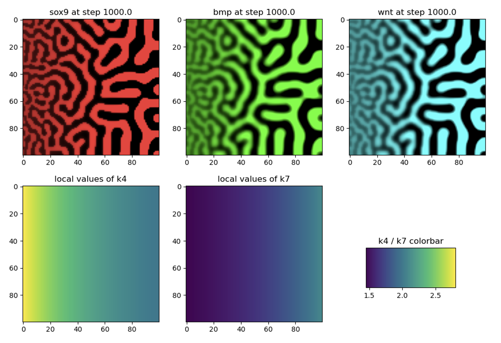
  >
  > This results in $k4$ decreasing and $k7$ increasing along the x-axis.
  > Wavelength of the Turing pattern increases more than 2-fold
:::

------------------------------------------------------------------------

## Hoxd13 and FGF

As mentioned above, the biological factors thought to underlie the variation in 
the $k4$ and $k7$ parameters are Hoxd13 and FGF. Hoxd13 is highly expressed in 
the distal domain of the paddle and not expressed elsewhere, and this expression 
domain is growing as the paddle grows. FGF is expressed from the distal edge of 
the paddle and **spreads** through diffusion. See [page 10, Fig S8A](https://www.science.org/doi/suppl/10.1126/science.1252960/suppl_file/raspopovic.sm.pdf)). 
Experimental data suggest that Hoxd13 and FGF together affect $k4$ and $k7$, 
which the authors decided to model using the following equations:

$$
k4^* = k4 - k_{HF_{bmp}} * fgf(i,j) * hox(i,j)
$$

$$
k7^* = k7 + k_{HF_{wnt}} * fgf(i,j) * hox(i,j)
$$

:::{#exr-tur}

## Algorithmic and biological thinking 

The script `WC05_digits_square--Question7-hoxdfgf` implements how $k4$ and $k7$ 
are a function of local FGF and Hox values (line 116 and 117), but does not yet 
include Hox and FGF spatial patterns and how these develop over time. Adjust the 
code to incorporate the observed Hoxd13 and FGF patterns, and assess how the digit 
patterns compare to what you found in the Question 6. 

Note that the code already defines the arrays for `hox` and `fgf`, as well as the
decay and diffusion values for `fgf` are provided already in the code. Also note 
that `hox` and `fgf` each have a maximum value of 1.

Hint: (1) Initialize the spatial distribution of Hox and FGF, (2) Model the diffusion 
of FGF, (3)  model how the expression domain of Hox increases with growth, and (4) update 
your simulation loop to account for these new processes.
:::

:::{.content-visible when-meta="params.show_answers"}
> **Answer** 
> See the script `WC05_digits_square-Question7-hoxdfgf_answer` for a solution. 
> You can find the important code lines by searching for "Question7)
>
> The output may look sometimes like this:

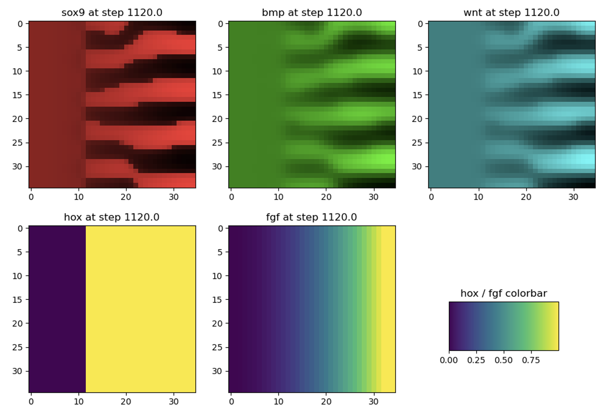
  > The Hox domain starts as a narrow vertical band and expands backward. The FGF 
  > gradient develops from the rightward boundary. Since a certain amount of Hox 
  > and FGF is needed to result in $k4$ and $k7$ values permissive of Turing patterns, 
  > the stripes develop from right to left. Also, the different Hox and FGF values 
  > along the proximo-distal axis cause wavelength changes (notice Fgf gradient...), 
  > resulting in the stripes becoming closer together towards the left end. 
  > Here we show a nice example output, but patterns are variable.

:::
------------------------------------------------------------------------

## Shape makes the tissue

Having studied the effects of growth and genetic factors modulating the 
Turing pattern now it is time for the final step: shape!

So far, we’ve approximated the limb bud very crudely with a rectangle. As you 
probably noticed in your parameter exploration, the tissue boundary can bias 
stripe orientation. Therefore it is interesting to study the interplay between 
the shape of the “paddle” or limb bud in which the digits develop, and how it 
grows with the temporal development of the hox and fgf patterns. In the script `WC05_digits_Question8-growingpaddle.py` we implemented two different tissue 
geometries: An ellipse and a “paddle” that imitates the shape of the limb bud.

Note that to implement Hox and FGF domains on a complex growing shape, quite a bit 
of complex code involving masks was needed (needed to describe the tissue domain 
and angles to control the Hox and FGF domains). We are going to ignore these 
technical details (for now).

:::{#exr-tur}

## Biology

Switching between geometries is easily done by changing the value of the parameter 
`geometry` on line 78 of the script. Start with the “ellipse” geometry. What do you 
observe with regards to the FGF gradient? What consequences does this have? 
Why would this be “a smart thing to do”?

Play around with $vi/vj$ and $Lx0$ to investigate the effect of ellipse shape and 
development over time on the number, shape and robustness of digits that form.

Now switch to the paddle geometry. Observe the patterns that emerge and compare these 
to the simulated and experimentally observed patterns in Figure 3E and 3F of the 
Raspopovic article (@raspopovic2014digit). 

What does and what doesn’t the model explain well?

:::

:::{.content-visible when-meta="params.show_answers"}
  > **Answer**<br>
  > 
  > - The Fgf gradient forms from bottom to top. As a consequence the bottom fingers form 
  > first; often one of the bottom fingers forms and then splits. While in general 
  > Turing mechanisms give nice patterns, they are not reproducible in terms of the 
  > positioning of the stripes. Starting the highest point of the FGF gradient 
  > locally determines where the first digits arise, generating control over 
  > the positioning of all the digits.<br>
  > - $Vi$ 0.1 goes okay, 0.2 results in stretched and splitting of digits <br>
  > $Vj$ too low results in too little room, resulting in less than 5 digits. 
  > $Vi$ too high results in more than 5 fingers. Notably, higher rates result in 
  > less reproducible patterns
  > 
  > Below a nice pattern showing 5 fingers, but also showing near splitting of one 
  > of the fingers at the end<br><br>
  > - The model explains the formation and positioning of the 4 digits, and how the 
  > distance between these digits increases along the limb bud. However, the model 
  > clearly does not simulate/explain the formation of the wrist bones that is observed
  > experimentally. Interestingly the experimental data suggest that while digits may 
  > form from the “right to the left”, the “leftmost” bones of the wrist are there 
  > the earliest, suggesting there locally different conditions apply allowing 
  > earlier Turing patterning with a very large wavelength at the wrist.  <br><br>

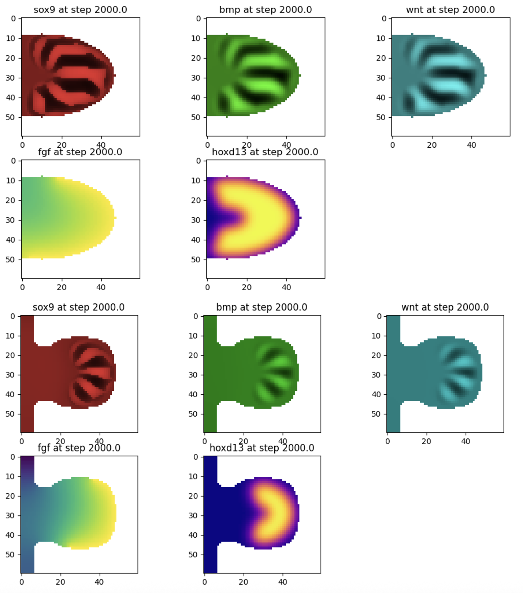


:::

**Technical details**: To implement non-square geometries, the script uses “masks”. 
Try the supplementary script `supp_i__geometries.py` in the Supp folder, and study 
how these masks are created in the functions `create_ellipse_mask` and `create_tissue_mask`. 


*Note:* For computational convenience, we use the “Class” data structure to implement 
common functions shared by the masks. This is a somewhat more advanced programming 
concept, so it’s ok if you don’t understand what it does yet. If you are curious, feel 
free to check out the supplementary script `supp_i__class_data_structure.py`.
------------------------------------------------------------------------

## Master students exercise 

:::{#exr-tur}

## Poly and oligodactyly

Above we played with ellipse size and growth rates, however in addition to mutations 
affecting tissue size and growth, also mutations in genes affecting the Hox and FGF 
morphogens may occur. Play with the parameters that determine Hox and FGF expression zones 
on the paddle geometry. Which parameter changes lead to the formation of supernumerary 
fingers (polydactyly)? Which parameters lead to too few fingers (oligodactyly)?

*Hint:* The following supplementary scripts will be helpful to understand how the 
FGF and Hox domains were coded:

-   `supp_i__ellipse_slice.py` visualizes the usefulness of masks based on the 
example of selecting a slice of an ellipse;
-   `supp_i__smooth_function.py` visualizes the function `smooth_function()`;
-   `supp_i__morphological_operations.py` visualizes morphological operations 
(binary dilate/erode and Gaussian blur) which are used for mask operations, 
calculating the Laplacian on the irregular domain, and to select pixels to 
generate the FGF and Hox pattern;
-   `supp_i__maskDifference.py` visualizes the difference of masks, which is 
how the function `single_step_growth()` checks if the tissue domain is growing 
or shrinking.

:::

:::{.content-visible when-meta="params.show_answers"}
> **Answer**
Reference values:
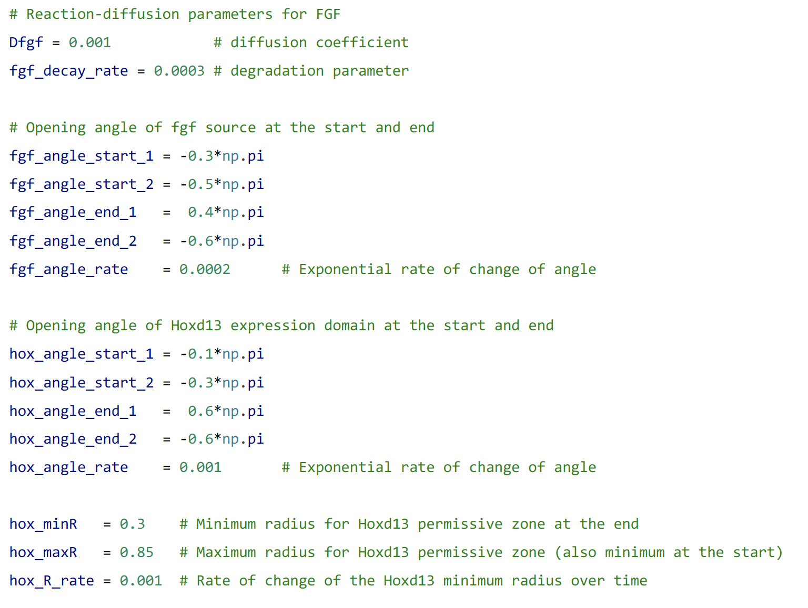{#vegmini1 width=140%}

> Decreasing FGF diffusion increases the number of fingers and creates a fin-like 
> appearance. However note that it also creates a shorter finger forming domain. 
> Increasing FGF diffusion decreases the number of fingers.

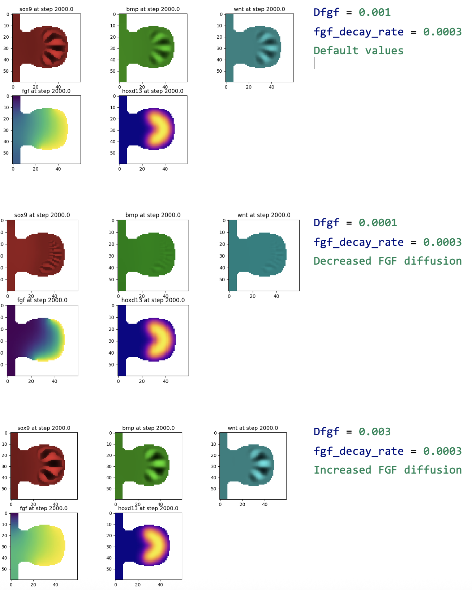
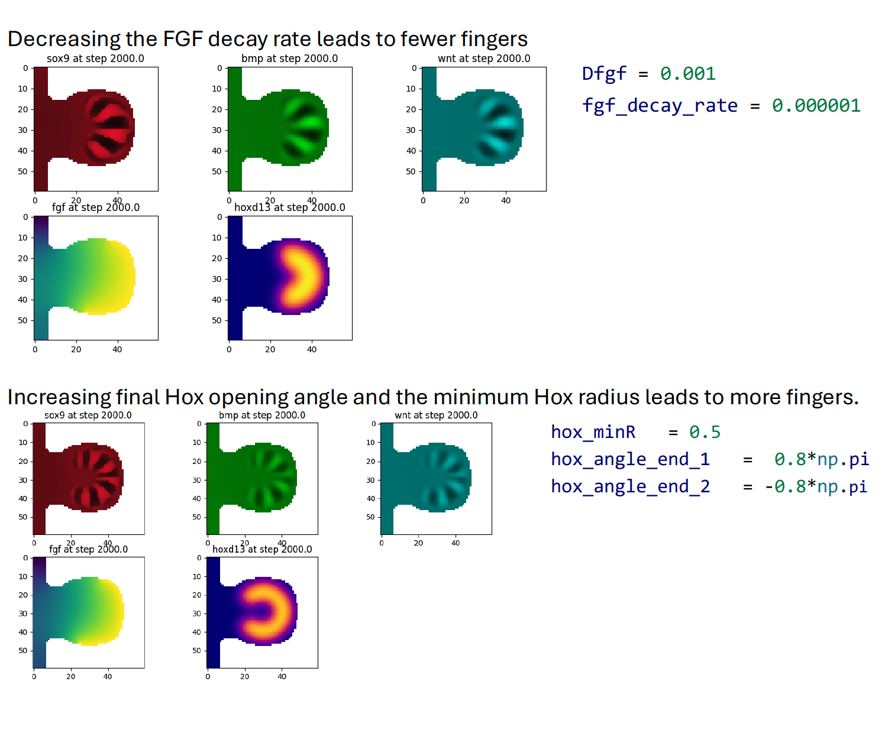

:::


### References
