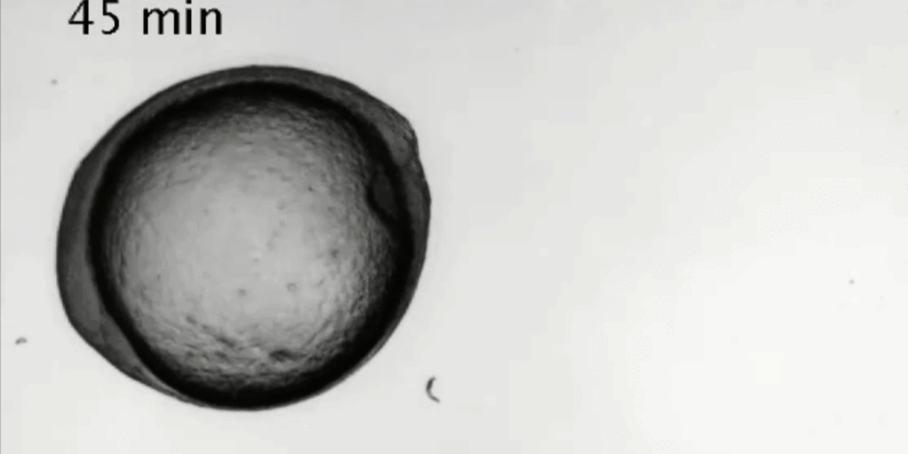
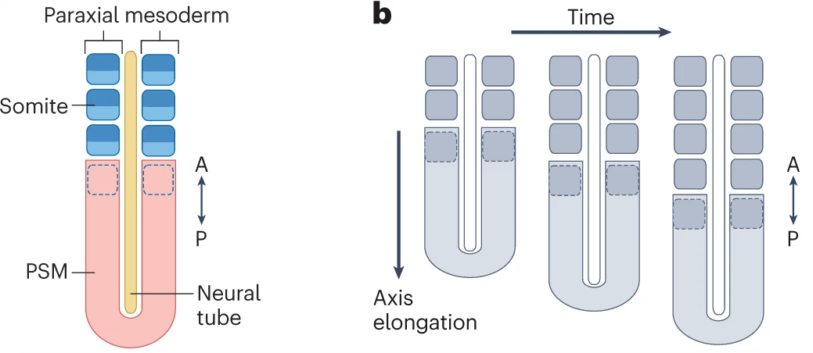

---
params:
  show_answers: false
---

# Clock-and-wavefront patterning

## Goal of the tutorial:

In this tutorial you will look at a new mechanism for gradient formation and 
patterning, different from what we have seen in previous practicals. We will 
study the so-called clock-and-wavefront model, in which the patterning stems from 
oscillations in gene expression and gene products, and results in a 
regularly striped segmentation pattern in a growing tissue. Note that 
as compared to the Drosophila French Flag type case (WC04), this is thought 
to be the evolutionary ancestral model of segmenting animal body axes.

{#vegmini1 width=60%}

## The model system

The clock-and-wavefront model describes somitogenesis, a process occurring early 
in embryo development to form somites along the anterior-posterior (head-to-tail) 
axis of vertebrates. Somites are a precursor tissue for vertebrae (and other 
tissues) that will form later in development. Somites are formed from the 
pre-somitic mesoderm, that extends on the posterior end of the embryo 
by growth, while the somites bud off periodically at the anterior end. This 
dynamic developmental process is in the order of a couple of weeks (in humans).

Key players regulating somitogenesis are the protein FGF, and many genes and gene 
products that have an oscillatory behavior that will determine cell fate. 
However, for this tutorial, we simplify this oscillatory network to a single 
pair of gene mRNA and product, denoted with $m$ and $p$ for short.
{#vegmini1 width=60%}

## Programming with classes

In this practical we are going to make a more complex model with a tissue 
made up of multiple cells, and each cell having its own concentrations of FGF, 
$m$ and $p$. We are going to use Classes in our code. You have been using
Classes already: the data types such as `int`, `str` and `bool` have their own
class; moreover the `str` class has many *methods* (=functions working on that
class) defined, such as `"hello world".upper()`. It is also possible to create 
custom classes, which is how we will model our genes, cells, and tissue today. 
With classes, you can easily make objects (an instance of a class), which is 
part of the object-oriented programming paradigm.

Today, we are going to use classes for the different levels of our
model: 1) tissue, 2) cell, 3) $m$ & $p$ clock and 4) the plotting. By using
classes, we can separate things that happen on a tissue/cellular/clock
scale, and separate the model from the visualization of it. You will
first work with 1 & 2 & 4, then 3 on its own. At the end you will combine the 
four into one model, to study somitogenesis.

Important concepts when working with classes are

-   Class versus instance
-   Defining the `__init__` method and other methods
-   Class attributes and using the keyword `self`

This practical should be doable without an extensive knowledge of classes
as we provide plenty of examples to copy-paste and run. If you are curious 
and want to understand better how classes work we recommend you to read 
[this online tutorial](https://www.datacamp.com/tutorial/python-oop-tutorial)

## Questions

:::{#exr-test}

## Biology - An alternative gradient forming mechanism
In practical WC04-Gradients and segments we study how gradients can be created 
through local production, diffusion and decay. However, other mechanisms for 
gradient formation are possible, such as cell lineage transport. Important for
this mechanism is that the expression of the molecule forming a gradient is 
constraint spatially. In our model of somitogenesis, the rightmost/posterior 
cell produces FGF. This cell grows, and upon division the daughter cells inherit 
FGF from their mother cell. Note that only the mesoderm cell divides.

Open the code of the model for the FGF gradient (`WC06_fgf-gradient-growth-START.py`).
First study the code to see how it uses Classes, how they are initialized, and 
attributes they have. 

Run the model and play with it by varying the decay rate of FGF and the 
division rate of the cells. 

How does this affect the gradient? What happens if divisions are only allowed 
during the first half of the simulation (put `divisiontime` to 0.5 instead of 1)?

:::

::: {.content-visible when-meta="params.show_answers"}

  > **Answer** 
  > The formation of the FGF gradient requires that FGF is stable enough to be 
  > inherited by the daughter cells of the rightmost cell (mesoderm). 
  > When we increase the decay rate of FGF, its maximum level goes down and the 
  > gradient become steeper and shorter. This occurs because for the time between 
  > divisions more decay takes place, as well as the FGF inherited by the 
  > daughter cells decays faster. 
  > 
  > Moreover, the FGF gradient is modified by the growth rate of the mesoderm (rightmost cell). 
  > If the growth rate increases, then cell size increases faster resulting  
  > in the dilution of FGF. Hence the gradient is less steep and will have a lower 
  > maximum. Due to FGF being a stable protein quite some time is needed to 
  > compensate for this decrease by more production. 
  >
  > Lastly, the FGF gradient requires of divisions of the mesoderm (rightmost cell). 
  > If growth stops halfway the simulation, no more division occurs. This results 
  > in FGF in rightmost cell increasing (as there is no longer any loss due to 
  > growth-induced dilution) while FGF the rest of the cells goes to zero due 
  > to decay. Thus, the FGF gradient depends on the influx of newly divided cells 
  > having inherited FGF from the proliferating rightmost cell.
  
:::

:::{#exr-test}
## Mathematics

Now, let's look at the other half of the clock and wavefront model: the clock 
part. In `WC06_clock.py` we implemented one of the first models for the 
somitogenesis oscillator [Lewis (2003)](https://doi.org/10.1016/S0960-9822(03)00534-7) which models a gene that
codes for an mRNA ($m$) translated into a protein ($p$) that acts as a repressive 
transcription factor repressing its own promoter. In class we 
discussed how negative feedbacks, delays and non-linearity are important for 
oscillations. Examine the code to find the differential equations governing 
this oscillator, and determine the negative feedback, delay and non-linearities in them.
:::

::: {.content-visible when-meta="params.show_answers"}

  > **Answer** 
  > The negative feedback is because this gene affects own expression negatively 
  > (m -> p --| m), the delay is modeled explicitly through a special delay-type 
  > differential equation, and the non-linearity is in saturation function with 
  > power n. 
  
:::

:::{#exr-test}
## Biology

Play with the parameters of the model. You can see the output of each simulation 
as a .png image in `WC06_Pattern_formation_III/output`. 

How does the delay ($\tau$) affect oscillations? 
   

:::

::: {.content-visible when-meta="params.show_answers"}

   > **Answer** 
   > Larger value of $\tau$=delay results in a longer period 
   > (lower frequency) and higher amplitude. Remember how in class we 
   > discussed how removing introns reduced delays and affected oscillator 
   >period.
:::

:::{#exr-test}
## Algorithmic thinking

In the file `WC06_rolling_clock.py` there is a different implementation of the 
clock. Compare the two clock models and find out how they differ. Ignore the 
new functions `__copy__` and `set_tau` in this comparison. 
**Hint**: Some differences become clearer when you run the code too.

What benefits does `WC06_clock.py` have over `WC06_rolling_clock.py` and vice versa? 
:::

::: {.content-visible when-meta="params.show_answers"}

  > **Answer** 
  > Working with delay functions implies that you need the value 
  > of a variable not on the current time but on time-$\tau$. In the previous 
  > model (`WC06_rolling_clock.py`) we simply memorized the entire history of 
  > both variables. In `WC06_rolling_clock.py` we only store the variable state 
  > for the length of the time delay $\tau$. This saves memory and hence runtime. 
  > This will become especially important when simulating a larger number of 
  > individual cells each having their own clocks.  
  > You probably notice this difference in the plotting of each clock model, as 
  > each shows the stored values. In `WC06_rolling_clock.py` we only see what 
  > happened between current_time-$\tau$ and current_time, while in `WC06_rolling_clock.py`
  > we see what happened from start of simulation till current time.  
  > Notice that if you were to dynamically change $\tau$ you will need to make 
  > sure you store values over an interval corresponding to the largest possible 
  > value of $\tau$, which you will need to know beforehand. 
  > Tip: look for "self.t_values" in the codes to spot the differences.
:::

:::{#exr-test}

## Programming

Now, the fun part starts: we will study the combination of the clock and FGF 
wavefront into a single model (!!!). 

**Read and interpret existing code:** Read the code of `WC06_clock_and_FGFgradient.py`, 
see where the clock and the FGF models are, how they are coupled. Next, identify 
the assumptions of this model implementation by answering the 
following questions:

  1.  Each cell has its own clock. What clock states is the tissue
        initialized with? And, what clock states do newly divided
        cells get?
        
  2.  The FGF wavefront affects $\tau$: what function is used for
        that? How do you expect the FGF wavefront to affect the cells' 
        clocks?
        
  3.  Does growth affect the clock state?
    
  4.  What is your opinion on the assumptions discussed in the three
      questions? How do you think they impact the observed patterning?
:::

::: {.content-visible when-meta="params.show_answers"}
   > **Answer**
   >  
   > 1. To see how the clocks are initialized you need to open the code 
   > `rolling_clock.py`. Remember that each class has its __init__ function, so 
   > the `Clock` class and the `Cell` class each have their respective __init__. 
   > Now, the __init__ function of the Class `Clock` is called in the __init__ of 
   > Class `Cell`: as `self.clock=Clock(..)` receiving $m0$ and $p0$  as arguments.  
   > The default values are $m=0$ and $p=0$, and newly divided cells inherit clock 
   > state and and FGF value from their mother cell.
   > In a sort of inception-like way, the initialization function of Class `Cell` 
   > is called from the initialize_regular_tissue function of Class `Tissue` 
   > when the first cell is created. Thus a class `Tissue` is initialized by initializing 
   > objects of class `Cell`, that initialize objects of class `Clock`. 
   > 
   > 2. Look at the function `update_clock_tau` in the Class `Cell`:
   > $$\tau_\text{cell}=\tau_\text{model}(1+0.5\frac{100-\text{FGF}\_\text{cell}}{100}),$$  
   > So if localfgf=max=100,  $\tau{local}$=$\tau{global}$, and if localfgf=min=0
   > $\tau{local}$=1.5*$\tau{global}$ 
   > So for lower FGF, $\tau$ will increase, slowing down the oscillations. 
   > 
   > 3. Growth does not affect the clock directly. The growth of cells leads to 
   > size increase and potential FGF dilution effects, but this does not affect $m$ 
   > or $p$ levels. However, growth indirectly affects the clock since growth 
   > affects FGF concentration, and FGF regulates $tau$. 
   > 
   > 4. (1) Initialization is somewhat arbitrary, (2) inheritance from mother 
   > cells is logical although in reality it is noisy and this is not accounted 
   > for, (3) FGF effect is also reasonable to produce the observed the waves and 
   > the slowing of the clock. Yet, it would be more logical for the clock state 
   > to also be diluted by growth. 
:::

:::{#exr-test}

## Biology

Describe how the model behaves and why. Reverse the effect of FGF and see how 
that affects the patterning? **Does the model produces stable somites?**
:::

::: {.content-visible when-meta="params.show_answers"}

  > **Answer** 
  > As the simulation starts from a single mesoderm cell, first there is a 
  > startup period where we have  synchronized oscillations in the first cells 
  > produced that have high FGF.  
  > As the tissue grows and the FGF gradient forms, we observe waves of 
  > oscillations moving from right to left with increasing amplitudes. The 
  > right to left movement arises because oscillations are faster on the right 
  > than on the left (remember the FGF effect over $tau$). This difference in 
  > oscillation frequency arises from the impact of FGF on oscillator frequency. 
  > However, the oscillations persist along the tissue... Therefore the model 
  > does not produce a stable spatial pattern. This is because there is no 
  > memory mechanism in place.
:::

:::{#exr-test}
## Biology & Programming

The oscillations slow down, yet they persist... Somitogenesis requires stable 
somites, indicating something is still missing in the model. That is a means to 
transform the temporal oscillations in the right-most end of the tissue (posterior) 
into a spatial pattern of cells at the left (anterior end). In the French Flag 
morphogen gradient lecture we discussed that memory mechanisms are important to 
stabilize spatial patterns. Particularly important when the start up signal that 
*broke the symmetry* and initialized patterning is gone. It turns out that such 
a memorization/stabilization mechanism is also essential to convert oscillations 
to stripes (somites!).

7.a.	In `WC06_clock_and_FGFgradient_memory.py` we added an extra ‘memory’ 
molecule  $M$ as a new attribute to the Class `Cell`, which value is inherited 
from the mother cell upon division. The code already includes the visualization 
of $M$. Write your own code to update the function `run_clocks` in the 
class `Tissue`: define $M$ regulation and how $M$ controls the clock updating. 
Remember that memory requires bistability, which can be achieved if ++++
the memory molecule $M$ has a non-linear saturating positive feedback on itself. 
What happens when initializing $M$ with different values (try low and high values)?

::: {.callout-note collapse="true"}
## 7.b. Continuation...

7.b.  To make $M$ expression non-homogenous in the tissue we need to make $M$ 
dependent on the clock. To achieve this, we can initialize the cells with low 
values of $M$ (low enough prevent its autoactivation), and then have $M$ being 
activated by either $p$ (part of the clock) **OR** $M$ itself. This is 
implemented in the following function: 
            $$\frac{dM}{dt}=c\max\left(\frac{p^4}{h_p^4+p^4}, \frac{M^4}{h_M^4+M^4}\right)-\delta M.$$
    c= production rate, max() is the OR function, $h_M$ and $h_M$ are the half rates,  \delta is the decay rate.
            
  Implement this function in the code. What happens now? How is M expressed in the tissue?
           
:::

::: {.callout-note collapse="true"}
## 7.c. Continuation...

7.c.  Since oscillations occur in the posterior end, and stripe formation occurs 
at the anterior end, we can use $FGF$ as molecular information to define where 
the memorization occurs. Specifically, we should constrain memorization to occur 
only below a certain $FGF$ value. Implement this in the code. How does this 
change $M$ expression in the tissue?

:::

::: {.callout-note collapse="true"}
## 7.d. Continuation...

7.d. So in addition to memorization occurring only below a certain $FGF$ value, 
it should also occur above another, lower $FGF$ value. This will constrain 
memorization to limited temporal window that enables cells passing through 
with a high  $p$ state to induce a high $M$ state, while cells with a low $p$ 
state to not induce a high  $M$ state. Implement this lower $FGF$ threshold and 
see if you get stable somite formation. Can you think of another way of achieving this?
:::

:::
::: {.content-visible when-meta="params.show_answers"}

  > **Answer** 
  > See code `WC06_clock_and_FGFgradient_memory_answers.py` for the solution.
  >
  > a. If initial values, are low $M$ will remain low everywhere. On the contrary,
  > if initial values are high, autoactivation starts working and $M$ will 
  > be high everywhere. This is how the $M$ auto-regulation works. We wish 
  > to have the memorization at the anterior (left) side of the tissue, so this
  > does not work...
  > 
  > b. This also doesn't work because despite $M$ being linked to the clock and 
  > $M$ starting low, $M$ still becomes high everywhere. This is because each 
  > cell eventually goes through a clock phase with $p$ high...
  > 
  > c. Now $M$ stays low posteriorly where $FGF$ is still high, however as 
  > $FGF$ drops cells exiting that zone still oscillate, pass through all 
  > phases (including the one with high $p$) and hence anteriorly all cells get 
  > a high $M$ level.
  >
  > d. The two thresholds should be relatively close to ensure stripes of low 
  > and high $M$ forming. 
  > Restricting only certain cells to have high $M$ can also be achieved by 
  > stopping oscillations after certain $FGF$ level.

:::
:::{#exr-test}

## Biology

Both zebrafish and mice are common model organisms in the life sciences. This means
we know a lot about the biological parameters regulating their somitogenesis. 
See the following list:

| Parameter                           | Zebrafish             | Reference                                                                                                                                            | Mouse                                                                     | Reference |
  |----------------------------------------------------------------------------------|----------------------------------|-----------------------------------------------------|---------------------------------------------------------------------------|-----------------------------------------------|
  | Duration of somitogenesis | 18 h                  | @stickney2000somite                                       | 5 days                                                                    | @saga2012mechanism     |
  | Number of somites         | ~30                   | @stickney2000somite                                       | 65                                                                        | @tam1981control |
  | Somite size               | 50 $\mu$ / 30 $\mu$  | @ishimatsu2018size @stickney2000somite    | 120 $\mu$                                                                 | @tam1981control |
  | Cells per somite          | ~5 cell in diameter   | @stickney2000somite                                       | 5-11 (estimated from total cell size in 3D, ranging 1 order of magnitude) | @tam1981control |
  | Clock period              | 25 min /30 min        | @ishimatsu2018size / @carraco2022vertebrate / @tomka2018travelling | 2-3 h                                                                     | @carraco2022vertebrate     |

From these parameters, you can derive a number of features for each specie, 
that can be used to make a model:

-   The total size of the tissue at the end of somitogenesis
-   The size of a cell
-   Speed of division

Use the model and try to find suitable model parameters to recreate the 
somitogenesis development of zebrafish and mice. 
Is this model able to describe both species? In other words, is this model 
able to deal with the scale differences between zebrafish and mice?

A couple of notes:
- You don't have to exactly recreate the biological parameter with 100% precision, 
but in terms of the number of segments/somites (although it can be a fun 
challenge to get a complete match).
- You might want to adapt your plotting timestep to have not too many plot 
updates in one simulation.
- You can test the clock parameters separately with the `WC06_clock.py` and 
`WC06_rolling_clock.py` scripts. And remember that FGF has an effect on $\tau$!
:::

::: {.content-visible when-meta="params.show_answers"}

  > **Answer** 
  > See codes `06_answers_clockplusfgf_memory_mouse.py` and
  `06_answers_clockplusfgf_memory_zebrafish.py`.
  > 
  > **Zebrafish:**
  > 
  > Totaltime: 18 hours for duration of somitogenesis + 10 hours startup phase.
  >
  > Cell width= 30-50 $\mu$ sized somite/5 cells per somite = 6-10 so 8
  > 
  > Growthrate: 30 somites x 5 cells x 8$\mu$ / 18 hours = $1200$\mu$/18*3600$s
  > 
  > For clock frequency:
  > 
  > $\tau$ times 0.25
  > 
  > Fac = 6 (multiplies alpha, beta, mu, v)
  >
  > This gives 32/31 somites with on average 4.9 cells, so perfect.
  > 
  >
  > **Mouse:**
  > 
  > Simply doing the computations would give you: 
  >
  >
  > Totaltime: 5 days for duration of somitogenesis + 15 hours startup phase
  >
  > Cell width = 120$\mu$ sized somite/5-11 cells = $120/8=15$
  >
  > Growthrate: 65 somites x 8 cells x 15$\mu$ / 5 days = $7800/5* 24 *3600$s
  >
  > For clock frequency:
  >
  > $\tau$ times 1.4-1.6 is sufficient (Fac=1 (multiplies alpha, beta, mu, v))
  > 
  > Somehow this does not fully work:
  > 
  > Too few cells (not $65*8=520$) too short tissue (not $65*8*15=7800$) and only 
  > 24 segments. First, remember $\tau_{local}=(1+0.5 *(100-localfgf)/100))*\tau_{global}$. 
  > So $\tau_{local}$ max 1.5 times $\tau_{global}$  so the also increasing $\tau_{global}$ 
  > 1.4-1.6 times 1.5 makes it really slow. Indeed $\tau$ times 1.2 gives 31 segments, $\tau$ 
  > times 1 gives   > 36 segments, $\tau$ times 0.7 gives 49 segments
  > 
  > Good to realize that the numbers in the table do not completely add up:
  > 
  > If it takes 5 days =$5*24=120$ hours, and the period is 2-3 hours this would result 
  > in 40-60 segments but never 65. For a duration of 5.5 days and $\tau$ times 0.6 we 
  > get to 62 somites of size 9, so quite close.

:::

:::{#exr-test}

## Questions for master students

The model currently has a number of assumptions that we can
  question. Feel free to explore any of these further open questions
  and study how it effects the outcome of the model:

-   What if the relationship between FGF and $\tau$ is shaped differently?
    For instance, if the clock runs faster on the left/anterior than on
    the right/posterior?
-   What if the clock state of a daughter cell is started fresh rather
    than being a copy from the mother cell?
-   What if the clock $m$ and $p$ are diluted by growth?
-   What if $\tau$ is unaffected by FGF: can we still get somites fixed in
    place?
:::

::: {.content-visible when-meta="params.show_answers"}

  > **Answer** These are open questions and do not have a single correct answer. Feel free 
  > to discuss with us if you find something interesting or have an interesting answer. 
:::

## Recommended reading material:

If you want to know more about somitogenesis and how it has been modeled,
have a look at the following papers (after the practical :): @lewis2003autoinhibition, @hester2012multi, 
@herrgen2010intercellular, @soroldoni2014doppler, @sonnen2018modulation, @bulusu2017spatiotemporal,
@van2025scaling.
------------------------------------------------------------------------------------------------------------------