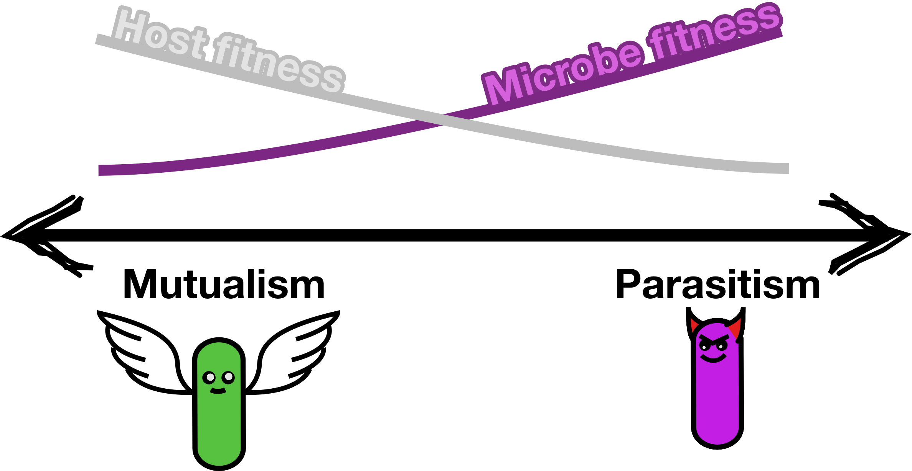

---
params:
  show_answers: false
---

# Miniproject: the evolution of virulence in space

## Mini description

Host-associated microbes come in all flavours (@fig-parmut). Most are **commensals** that live on a host without doing much to it. Some are **mutualists** (helpers) that invest in their host, at a cost to their own growth, and some are **pathogens** that grow faster by exploiting their host. How virulent a microbe becomes is the outcome of selection at two levels: *within* hosts, the fastest-growing microbe wins, but *between* hosts, the hosts that carry the "nicest" microbes live longest and reproduce most, and so do the microbes they carry (van Vliet & Doebeli, 2019). In that light, the host can be seen as a *collective* of microbes that is selected as a whole, which can help to prevent the emergence of pathogens. However, this depends on how microbes travel between hosts (vertically, from parent to offspring, or horizontally, between unrelated hosts) and on whether those hosts are spread out in space. That is what this mini project will investigate. 

{#fig-parmut}

## The project

In this mini project you study how virulence evolves, and how host-level selection and spatial structure stop it from running away. 

To start, you get a well-mixed model (ODEs) with a host population $H$, a resident population of neutral microbes $N_r$ that live on these hosts, and a mutant microbe $N_m$. The mutant differs from the resident in two ways: it has a different growth rate on the host (a fraction $v$ faster, which can be negative), and it has an effect $e$ on the host (positive for a mutualist, negative for a pathogen). Hosts grow logistically, microbes grow logistically on the hosts, and the mutant is introduced at a low density once the resident and the host have reached equilibrium:

$$
\frac{dH}{dt} = bH(1-H) - dH + eN_m
$$

$$
\frac{dN_r}{dt} = rN_r(H - N_r - N_m) - \delta N_r
$$

$$
\frac{dN_m}{dt} = r(1+v)N_m(H - N_r - N_m) - \delta N_m
$$

Here $b$ and $d$ are the birth and death rate of the hosts, $r$ and $\delta$ the intrinsic growth and death rate of the microbes. A sensible starting point is $b = 0.1$, $d = 0.01$, $r = 1$, $\delta = 0.1$ (i.e. hosts grow and die slower than microbes). The parameters $v$ and $e$ determine the type of mutant: a pathogen grows faster ($v > 0$) but harms the host ($e < 0$), a mutualist is the other way around. 

First, study the ODE and find out which mutants can invade. Then build a **spatial, individual-based** version: hosts on a grid, each carrying a small population of microbes, with local host reproduction (offspring inherit the microbes of their parent) and horizontal transfer of microbes between neighbouring hosts. In this model, make virulence an **evolving trait**: every microbe has its own value, which mutates at birth, and which makes the microbe grow faster inside its host at the expense of the host's survival (a trade-off, see Alizon et al. 2009). Let the population evolve, and find out which level of virulence it settles at, and why it does not keep increasing even though a more virulent microbe always wins within its host. 

:::{.callout-tip}
## Team up with the *Fusarium* project
You get ODEs from us, but **no spatial model**. The students working on the *Fusarium* mini project (why store a gene on a fragile chromosome?) are in the opposite situation: they get a spatial individual-based model, but no ODEs. Both projects are about microbes on hosts and the conflict between what is good for the microbe and what is good for the host. Help each other out: show them how you set up and analyse your ODEs, and ask them how their spatial model is organised (grid, neighbourhoods, local reproduction and transfer). 
:::

## Guiding questions

1. Which mutants can invade the well-mixed ODE model: mutualists, pathogens, or both? Does the effect on the host ($e$) matter for invasion at all, and what does that tell you about the ODE? 
2. In the spatial model, which level of virulence evolves? How does it depend on the rate of microbe-transfer between hosts? 
3. Does a mixed version of your individual-based model (constantly mixing the grid) evolve the same virulence as the spatial one? Why, or why not? 
4. What if the mutant can mutate back into the neutral strain (e.g. a pathogen loses its pathogenicity gene)? Can it ever get the gene back? Does this matter, you think?

## Key references

- van Vliet & Doebeli (2019), *The role of multilevel selection in host microbiome evolution*, PNAS. <https://doi.org/10.1073/pnas.1909790116>
- Alizon et al. (2009), *Virulence evolution and the trade-off hypothesis: history, current state of affairs and the future*. <https://doi.org/10.1111/j.1420-9101.2008.01658.x>
- Nazir et al. (2026), *Spatial structure drives parasites to evolve into host defense systems*. <https://www.biorxiv.org/content/10.64898/2026.10.14.759074v1>

:::{.content-visible when-meta="params.show_answers"}

## Notes for teachers

**Invasion condition.** Without the mutant, the hosts settle at $H^* = 1 - d/b = 0.9$ and the resident at $N_r^* = H^* - \delta/r = 0.8$. A rare mutant then grows at rate $r(1+v)(H^* - N_r^*) - \delta = (1+v)\delta - \delta = v\delta$. So in the well-mixed model **only mutants that grow faster on the host ($v > 0$) can invade, and the effect on the host ($e$) plays no role whatsoever**. Mutualists ($v < 0$) never invade, however much they help the host; pathogens ($v > 0$) always invade, however much they harm it. This is the conflict in its purest form, and it is the motivation for the spatial model: there, a mutualist's benefit lands on its own host and thus on its own offspring, and a pathogen's damage lands on itself. 

**Tested outcomes** (Euler, dt = 0.01, mutant introduced at $N_m = 0.001$ at $t = 200$, extinction threshold $10^{-4}$, parameters as above):

| Mutant | $v$ | $e$ | Outcome |
|---|---|---|---|
| mutualist | -0.1 | 0.1 | fails to invade (gone at $t \approx 430$) |
| mutualist | -0.01 | 0.5 | fails to invade, very slowly (gone at $t \approx 2500$) |
| neutral but helpful | 0 | 0.5 | stays at its introduced frequency; drifts in a stochastic model |
| mild pathogen | 0.1 | -0.02 | replaces the resident, hosts drop from 0.90 to 0.73 |
| pathogen | 0.1 | -0.1 | replaces the resident, hosts drop to 0.26, microbes from 0.80 to 0.17 |
| pathogen | 0.1 | -0.2 | replaces the resident, hosts drop to 0.15, microbes to 0.06 |
| pathogen | 0.5 | -0.1 | replaces the resident, hosts drop to 0.21 |
| pathogen | 0.5 | -0.2 | **evolutionary suicide**: resident gone at $t \approx 540$; the host-pathogen equilibrium is an unstable focus (eigenvalues $0.0013 \pm 0.093i$, period $\approx 68$) so the oscillations grow until a trough crosses the threshold, hosts and pathogen both extinct at $t \approx 2650$ |
| pathogen | 1.0 | -0.2 | same, faster: everything extinct at $t \approx 1300$ |

The thing to point out for guiding question 1: the pathogen always wins the within-host competition, but the *population* it ends up with is much smaller than the resident's was (0.06 instead of 0.80 at $v = 0.1$, $e = -0.2$), and with enough harm it wipes out its own host and itself. Without an extinction threshold the ODE lets $H$ and $N_m$ linger at $10^{-20}$ instead, so students need to think about extinction (a cut-off, or a stochastic / spatial model). 

**What a spatial IBM does (tested with a quick implementation: 64 by 64 grid, each host carries up to 10 microbes, offspring copy the parent's microbes, one microbe per transfer event at rate $m$ between neighbouring hosts, 2 seeds per setting; a "mixed" control draws partners from the whole grid).** The results differ from the ODE in two steps, and it is worth separating them for the students:

1. *Binding microbes to hosts* (vertical inheritance) changes everything, even in the mixed IBM. The ODE treats all microbes as one global pool, so a pathogen's harm is spread over all hosts and a mutualist's help over all hosts, which is why $e$ drops out of the invasion condition. In the IBM the harm lands on the pathogen's own host and the help on the mutualist's own host. Consequently: a mutualist with a small cost ($v = -0.03$, $e = 0.5$) takes over completely when transmission is vertical ($m = 0$: $N_m \approx 0.8$), partially at $m = 0.05$, and fails at $m \geq 0.2$. A pathogen ($v = 0.5$) only invades with enough horizontal transfer: with $e = -0.05$ it needs $m \geq 0.2$ (mixed) or $m \geq 0.3$ (spatial); with $e = -0.2$ it does not invade at any $m$ tested (up to 0.5), because carriers die before they pass it on. Evolutionary suicide therefore does not happen in the IBM: a pathogen that harmful never gets going. This is the van Vliet & Doebeli result: host-level selection works when transmission is mostly vertical.
2. *Space on top of that* makes life harder for **both** mutants, which students may not expect. At $m = 0.3$ the pathogen reaches $N_m = 0.27$ in space versus $0.38$ mixed, and hosts stay at $0.67$ versus $0.58$; the spatial pathogen spreads as patches that open up empty space around them (local burn-out). Mutualists spread more slowly in space ($N_m \approx 0.3$ versus $0.65$ at $m = 0.05$ after 6000 steps) and fail at $m = 0.2$ where the mixed model keeps them at $0.13$. The reason is local competition: the extra offspring of a mutualist host land next to other mutualist hosts, i.e. on the sites its relatives were competing for, so much of the benefit is spent on kin competition.

The obvious controls (question 4) are thus: the IBM with global partners (isolates the effect of space from the effect of host-bound microbiomes), and the ODE limit (very high $m$, so that microbiomes are effectively a global pool). Expect the students' spatial model to differ in details (bottleneck at host birth, transfer rules, microbiome size $K$), and these details matter: a smaller $K$ makes within-host selection weaker and helps the mutualists.

**Letting virulence evolve (tested: trait $x \geq 0$ per microbe, within-host weight $1+x$, host death $d + c\,\bar{x}$, mutation at microbe birth, 64 by 64 grid, 10,000 steps; a 128 by 128 grid gave the same numbers).** Virulence evolves to a stable intermediate level that is set by the horizontal transfer rate, and space roughly halves it:

| transfer $m$ | spatial: mean $x$, hosts | mixed: mean $x$, hosts |
|---|---|---|
| 0.1 | 0.01, 0.88 | 0.01, 0.88 |
| 0.5 | 0.07, 0.77 | 0.12, 0.65 |
| 1 | 0.15, 0.56 | 0.24, 0.40 |
| 2 | 0.18, 0.50 | 0.32, 0.18 |
| 4 | 0.20, 0.34 | 0.35, 0.12 |

(with $c = 0.2$; a steeper trade-off $c = 0.5$ keeps $x$ below 0.1 everywhere). With mostly vertical transmission, virulence stays at mutation-selection balance near zero in both models: a host full of exploiters dies and takes its whole microbiome with it, which is host-level (group) selection doing all the work. With horizontal transfer, exploiters escape their dying host and virulence climbs, but **nobody commits evolutionary suicide**, not even in the mixed model at $m = 4$: transfer needs a living partner, so as hosts become rare the exploiters lose their escape route and the population settles at low host density instead of collapsing. Space adds a second brake: a patch of virulent hosts empties its neighbourhood and is refilled from milder patches, visible as a patchwork of mild and nasty regions on the grid. If you want students to see a true suicide that space prevents, transmission must not depend on host density, e.g. a free-living pathogen stage or an environmental pool that infects hosts at a rate independent of how many hosts are left. 

:::
